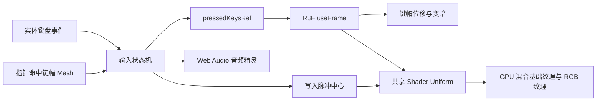

# Raycast 键盘交互实现拆解

> 本文基于 2026-08-29 的当前工作树，面向希望学习 React、React Three Fiber、Web Audio 与 GLSL 协作方式的前端开发者。文中的行号用于定位当前版本，后续改动可能使行号发生偏移。

## 先建立整体认识

这个键盘效果可以理解为一条实时反馈管线：浏览器接收实体键盘或指针事件，输入层维护按键所有权，渲染循环读取按压状态并修改键帽位置，同时触发声音切片和 GPU 光效。

React 在这里负责组件生命周期、资源装载和低频 UI 状态。每帧变化的键程、脉冲进度与材质亮度由 ref、Three 对象和 Shader uniform 承担，从而避免按住多个键时持续触发 React 组件重渲染。



整个实现可以分成五层。

| 层级       | 主要文件                     | 责任                                                             |
| ---------- | ---------------------------- | ---------------------------------------------------------------- |
| 装载与降级 | `hero.tsx`、`globals.css`    | 通过媒体查询与可视区状态动态加载 3D 场景，保留尺寸匹配的静态降级 |
| 场景与动画 | `scene.tsx`                  | 创建 Canvas、模型 Mesh、相机运动和逐帧键帽动画                   |
| 输入       | `input.ts`                   | 统一实体键盘、点击与拖动输入，处理多输入源所有权                 |
| 声音       | `audio.ts`、`sound-map.ts`   | 加载单个 OGG 音频精灵，按毫秒区间播放按下与松开声音              |
| 光效       | `shaders.ts`、`constants.ts` | 计算扩散脉冲，混合基础纹理与 RGB 纹理                            |

项目自有 CSS 只有 `src/app/globals.css` 一个入口，其中只定义 Tailwind 导入、`@theme` token 与两组命名 `@keyframes`。组件的布局、间距、颜色、断点、交互状态与伪元素均使用 Tailwind utilities，全局样式表不承担组件选择器职责。需要按条件组合 class 时，统一使用 `src/utils/cn.ts` 中基于 `cnfast` 的 `cn`，避免分散的手写拼接并正确合并 Tailwind 冲突。

## 一次 `KeyA` 按下经历了什么

### 场景启动

页面首次渲染时，`Hero` 同时输出桌面端固定槽与移动端静态图分支，由 `hidden`、`block` 和 `min-[1001px]:*` 等 Tailwind utilities 在断点处选择。桌面端的 400px 场景槽从第一帧起尺寸固定，但在 Three.js 尚未就绪时保持隐藏；移动端显示尺寸匹配的 WebP 静态键盘。

`Hero` 使用 `usehooks-ts` 的 `useMediaQuery` 读取 `(min-width: 1001px)` 和减少动态效果偏好，并通过 `defaultValue: false` 与 `initializeWithValue: false` 保持服务端/水合首帧可预测。只有桌面尺寸会渲染由 `next/dynamic` 引入的 `Scene`；`useIntersectionObserver` 则生成 `inView`，用于在场景远离可视区时停止输入与持续渲染。这样 SSR 不会先把大幅静态键盘绘制到桌面首屏，再突然缩成较小的 3D 模型。

`Scene` 创建 R3F `Canvas` 后，`Suspense` 等待以下资源：

1. `/assets/keyboard.glb` 键盘模型；
2. `/assets/base.jpg` 基础纹理；
3. `/assets/rgb.jpg` RGB 纹理。

资源就绪后，`createMeshStates` 遍历模型的直接子节点。当前 GLB 有 85 个根 Mesh，其中 84 个非静态 Mesh 会被代码视为可交互对象，另一个名为 `static`。这 84 个对象约对应 83 个逻辑键，其中还包含一块疑似 Space 附属几何。每个对象都保存原始位置、旋转、缩放、按压轴、当前键程和独立材质；`static` 底座不接收指针事件。

模型和纹理越过 `Suspense` 后，首次 `useFrame` 开始时，`KeyboardModel` 调用 `onReady`。此时相机已在 `useLayoutEffect` 中预置到确定的起始姿态，`Hero` 再让整个场景层以 500ms 淡入，背景和 Canvas 不会分两次跳变。资源请求或 WebGL 初始化若抛错，局部 `SceneErrorBoundary` 会让同一固定槽位显示尺寸匹配的 WebP 降级图，而不是把异常传播成整页错误。

### 按下阶段


`keydown` 进入 `useKeyboardInput` 后会按顺序完成三件事。

1. `keyboardKeysRef` 记录实体键盘仍占用 `KeyA`。
2. `press` 检查总按压集合。第一次按下才会写入 `pressedKeysRef`，浏览器的按键自动重复不会反复播放声音或创建光效。
3. `playSound(code, 0)` 播放按下声音，`onPress(code)` 将 A 键中心写入脉冲环形缓冲区。

输入层会在这条链路之前检查事件目标。焦点位于带 `href` 的链接、`button`、`input`、`select`、`textarea`、contenteditable 元素或 button/link role 时，场景完全忽略该次 `keydown`。焦点位于非交互页面内容时，方向键与 Space 仍可触发键盘光效，但输入层不阻止浏览器默认行为，因此页面原生滚动会同时保留。

### 松开阶段

`keyup` 先从 `keyboardKeysRef` 删除 `KeyA`。如果指针没有同时占用它，`release` 才会从总按压集合删除该键，并调用 `playSound(code, 1)` 播放松开声音。

这一层检查很重要。用户可以按住实体 A 键，再用鼠标压住屏幕上的 A 键；松开实体键盘时，画面中的键帽仍需保持下沉，直到鼠标也释放。

## 输入状态机如何处理并发输入

`input.ts` 用三个 `Set<string>` 表达输入所有权。

| 状态              | 含义                         |
| ----------------- | ---------------------------- |
| `keyboardKeysRef` | 当前由实体键盘占用的键       |
| `pointerKeysRef`  | 当前由指针占用的键           |
| `pressedKeysRef`  | 任一输入源仍占用的总按压集合 |

它们之间的约束可以写成：

```text
pressedKeys = keyboardKeys ∪ pointerKeys
```

代码没有每次重新计算这个并集。`press` 与 `release` 增量维护 `pressedKeysRef`，其行为如下。

| 操作顺序                       | 总按压状态 | 是否重复触发声音与光效 |
| ------------------------------ | ---------- | ---------------------- |
| 实体键第一次按下               | 进入按下   | 会                     |
| 浏览器重复发送同一个 `keydown` | 保持按下   | 不会                   |
| 实体键按住时，指针压住同一键   | 保持按下   | 不会                   |
| 实体键松开，指针仍压住         | 保持按下   | 不会播放松开声音       |
| 最后一个输入源释放             | 进入松开   | 会播放松开声音         |

### 指针拖过多个键

每个非静态 Mesh 都绑定同一组 `pointerEvents`。按下鼠标左键后，指针移动或进入新 Mesh 会调用 `enterPointerKey`：

1. 读取 `event.object.name` 作为键码；
2. 释放上一个指针键，但保留仍被实体键盘占用的键；
3. 将新键加入指针集合并调用 `press`；
4. 全局 `pointerup` 与 `pointercancel` 负责处理在 Canvas 外松手的情况。

因此，鼠标按住并横向划过键盘时，会依次产生接近真实扫键的视觉和声音反馈。

当前没有 `pointerout` 或空区域命中处理。指针从键帽移到键帽间隙、`static` 底座或 Canvas 空白处时，旧键会保持按下，直到进入另一个交互 Mesh，或者窗口收到 `pointerup` / `pointercancel`。场景停用时 `pointerEvents` 会整体移除，并静默释放全部输入所有权。

### 为什么这里使用 ref 和 Set

按键集合会被窗口事件修改，又会在每个动画帧中读取。若将它们放进 `useState`，每次按下和松开都会进入 React 调度，并让组件重新执行。当前实现通过 `useRef` 保留稳定引用，让事件回调与 R3F 渲染循环共享同一份可变数据。

这种设计的优势是输入到动画的路径短，并且不会制造逐帧 React 渲染。代价是状态变更不出现在 React DevTools 的状态时间线中，测试时需要直接验证状态机行为与最终画面。

### 防止“卡键”的清理策略

以下事件都会释放状态：

- 窗口失焦 `blur`；
- 页面可见性变化 `visibilitychange`；
- 全局 `pointerup` 与 `pointercancel`；
- `enabled` 变为 `false`；
- Hook 卸载。

`window` 与 `document` 上的通用事件通过 `usehooks-ts` 的 `useEventListener` 声明，监听器在目标或回调变化以及 Hook 卸载时由库统一清理。窗口失焦、页面可见性变化、禁用 Hook 和卸载会静默释放；`pointerup` 与 `pointercancel` 按正常松开流程播放声音。Mesh 上的 R3F 指针事件仍属于 React props，由领域 Hook 组装而不使用窗口监听器。

## 键帽下压如何模拟机械键程

### 模型命名就是交互协议

GLB 中的键帽 Mesh 名称需要与浏览器的 `KeyboardEvent.code` 对齐，例如 `KeyA`、`Digit1`、`ArrowLeft`。输入层传递的键码会直接用于：

- `meshByName.get(code)` 定位脉冲中心；
- `pressedKeysRef.has(mesh.name)` 判断当前键帽是否下沉；
- `soundMap` 查找对应声音片段。

这个命名约定减少了额外映射层，同时把模型导出流程纳入了前端接口契约。设计资源若把 `KeyA` 改成 `A`，实体键盘、Mesh 动画与光效会立即断开。

### 当前资产的命名差异

当前 GLB 只与 `soundMap` 精确共享 64 个名称。模型中有 20 个泛化名称：

```text
keys.276
keys.299 至 keys.311
keys.313、keys.314
keys.316 至 keys.319
```

音频表中则有 19 个在 GLB 中找不到同名 Mesh 的语义键：

```text
F1 至 F12、PrintScreen、Insert、PageUp、PageDown、Home、End、Fn
```

两组对象的数量和空间布局基本对应，但 GLB 没有保留语义名称，具体一一映射只能通过位置推断。`keys.319` 与 `Space` 几乎同中心、同宽，同时 Y 位置更低且几何更薄，资产证据表明它很可能是 Space 的附属几何，代码仍会给它绑定指针事件与独立材质。

泛化名称无法命中音频表时，`audio.ts` 会随机选一个字母键声音。因此页面不会完全静音，但随机回退会隐藏资产命名问题。更稳妥的生产方案是在模型导入阶段维护一张显式映射，并在开发环境对未知名称报警。

### 局部方向转换

每个键帽的按压方向由下面的关系得到：

```text
pressAxis = Vector3(0, -1, 0) 经过键帽原始 quaternion 旋转
```

直接减少世界坐标的 Y 值只适用于完全水平的键帽。先把局部向下轴变换到当前姿态，即使某些键帽有旋转，也能沿自身的机械行程移动。

### 逐帧阻尼

每帧会计算目标键程：

```text
targetDepth = pressed ? 0.025 : 0
delta = min(frameDelta, 1 / 30)
depth = damp(depth, targetDepth, 55, delta)
position = rest + pressAxis × depth
```

`THREE.MathUtils.damp` 使用基于时间的指数阻尼，比固定 `lerp` 系数更能适应不同刷新率。`MAX_FRAME_DELTA = 1 / 30` 会截断异常大的帧间隔，页面从后台恢复时，键帽和光效不会瞬间跳到终点。

按压还会同步修改该键材质的 `uDim`：

```text
pressedAmount = clamp(depth / 0.025, 0, 1)
uDim = 1 - pressedAmount × 0.4
```

键帽完全压下时保留 60% 亮度。位置和亮度同时变化，能补偿很短的几何位移，让按压反馈更容易被感知。

## RGB 扩散光效如何在 GPU 中计算

### 两张纹理承担两种视觉状态

- `base.jpg` 提供默认键盘外观；
- `rgb.jpg` 提供光效激活后的颜色。

Shader 依据每个像素到脉冲中心的距离，计算混合权重。CPU 无需更新纹理，也无需逐键创建 DOM 动画。

### 固定长度环形缓冲区

共享 Uniform 同时保存最多 10 个脉冲：

```text
uPulseCenters[10]
uPulseProgress[10]
```

按键触发时，`triggerPulse` 通过 Mesh 对象的 `getWorldPosition` 把当前世界 XZ 坐标写入槽位，将进度重置为 `0`，然后把游标移动到下一个槽位。第 11 次触发会覆盖最旧槽位，因此 GPU 循环长度始终固定。

每帧按以下速度推进进度：

```text
progress += delta / 0.9
```

一个完整脉冲约持续 0.9 秒。

### 片元着色器中的数学关系

对每个像素和每个脉冲，Shader 依次计算：

```text
p = clamp(progress, 0, 1)
e = 1 - (1 - p)³
r = 0.15 × e
d = distance(pixelWorldXZ, pulseCenter)
circle = 1 - smoothstep(r, r + 0.08, d)
fade = 1 - e
pulse = max(pulse, circle × fade)
```

这里的三次 ease-out 让圆形半径前段扩张较快、后段减速；`smoothstep` 提供 0.08 世界单位的柔和边缘；`fade` 让脉冲随年龄衰减。

多个脉冲使用 `max` 合并，没有做加法叠加。优势是快速连按时亮度保持可控，风险是两个光斑重叠时不会产生更亮的能量叠加。按公式观察，它呈现为扩张的柔边实心光斑。

当前 `DEFAULT_LIGHTING = 0`，最终颜色可近似写成：

```text
color = mix(baseColor, rgbColor, pulse × 2) × uDim
```

混合因子峰值可以超过 1，GLSL 的 `mix` 此时会产生外插，从而增强光效中心的对比。最后经过 Three 的颜色空间处理再输出到屏幕。

### 为什么共享脉冲 Uniform，却给每个键独立材质

`createKeyboardMaterial` 对 `sharedUniforms` 做浅层展开。纹理、脉冲中心和脉冲进度对象由所有材质共享，因此一次 CPU 写入会影响整块键盘。`uDim` 每次单独创建，使某个键按下时只降低自己的亮度。

这种结构在同步全局光效和独立按键状态之间取得了平衡。代价是每个交互键拥有一个 `ShaderMaterial`，材质数量与键数线性增长，也难以合并成单次实例化绘制。当前键盘规模下可控；扩展到数百或数千个对象时，应评估 `InstancedMesh`、属性纹理或统一缓冲区。

## 声音为何使用音频精灵

`key-sounds.ogg` 把所有按下与松开声音串成一个文件，`sound-map.ts` 记录 83 个键对应的毫秒区间。以 A 键为例：

```ts
KeyA: [
  [10161, 10335],
  [10335, 10384],
];
```

索引 `0` 是按下片段，索引 `1` 是松开片段。播放流程如下。

1. Hook 挂载时创建 `AudioContext` 与 `GainNode`；
2. 每次 Hook 挂载请求并解码一份 OGG，同一次挂载期间所有按键共享该 `AudioBuffer`；
3. 每次触发创建新的 `AudioBufferSourceNode`；
4. `source.start` 使用开始偏移和片段时长，只播放目标区间；
5. `onended` 断开并移除音源，卸载时停止剩余音源并关闭上下文。

多个按键可以并发创建 Source，并共享同一个已解码 Buffer 和 Gain。相比 83 个独立音频请求，音频精灵减少了请求数量和资源管理复杂度。

声音映射还提供别名和随机字母回退。模型出现未收录键码时，交互仍可能发出接近的机械键声；这能维持感知连续性，也会掩盖模型命名或映射缺失，开发环境最好记录一次诊断信息。

实际查找顺序是精确映射、别名映射、随机字母回退。`MetaLeft`、`MetaRight` 和 `ControlRight` 已有精确条目，所以对应别名不会生效；四个别名中，当前只有缺少直接条目的 `AltRight` 会使用别名。

## Next.js 装载与静态降级

### 客户端边界

`page.tsx` 保持为 Server Component，只组装 `Nav` 与 `Hero`。`Hero` 因媒体查询、弹窗状态和动态场景而成为 Client Component。`Scene` 也明确使用客户端边界，因为 WebGL、窗口事件和 Web Audio 都依赖浏览器环境。

当前整个 `Hero` 都进入客户端组件图，标题、文案和静态图片也需要水合。单页复刻的复杂度可控；页面继续扩展时，可以把场景门控和视频触发器拆成更小的客户端岛。

### 1000/1001px 的双重防线

下表描述首次直接打开页面时的正常路径。

| 视口                    | JavaScript 行为                         | Tailwind utilities 行为                          | 用户看到的内容                 |
| ----------------------- | --------------------------------------- | ------------------------------------------------ | ------------------------------ |
| `≤ 1000px`              | 不渲染 `Scene`，并复位桌面就绪/失败状态 | 桌面槽 `hidden`，移动静态分支 `block`            | WebP 静态键盘                  |
| `≥ 1001px` 且场景未就绪 | 动态加载 `Scene`                        | 桌面槽改为 `block`，固定 400px 且保持不可见/透明 | 稳定的页面几何，没有大图换小图 |
| `≥ 1001px` 且场景就绪   | Canvas 运行                             | 条件 class 让整个场景层在 500ms 内淡入           | 可交互 3D 键盘                 |
| `≥ 1001px` 且场景失败   | Error Boundary 接管                     | 同一 400px 槽位显示降级图，移动分支保持隐藏      | 尺寸稳定的静态键盘             |

`useMediaQuery` 在这里使用 `false` 作为默认值且不在水合首帧主动读取视口，避免服务端猜测视口宽度；Tailwind 的桌面/移动显示 utilities 同时保证 SSR 阶段不会把移动端大图显示在桌面首屏。媒体查询跨过断点时，`Hero` 会卸载或重新挂载 3D 场景并复位 `sceneReady` / `sceneFailed`，因此桌面缩到移动端后静态键盘会立即恢复。

正常首次装载路径有三个直接收益：

- 首屏不等待 GLB、纹理和 Three.js 分块；
- 移动端绕开 WebGL 运行成本；
- 正常下载、解析和纹理解码期间保持完整的视觉占位。

对应的代价是移动端没有键盘交互，桌面端则需要同时维护静态图与 3D 模型的视觉一致性。

## 相机和场景入口动画

Canvas 初始相机位于 `[0, 4.5, 0]`，目标位置为 `[0, 3.5, 1.5]`，视野角为 20°。相机在布局阶段先固定到起点，模型首帧就绪后，`CameraRig` 用阻尼系数 4.5 把相机平滑推向目标位置，并在活动帧中重新看向原点。

与键帽动画相同，相机也截断帧间隔，避免恢复标签页时突然跳变。`motion-reduce:*` utilities 会关闭引用全局 keyframes 的入场/淡入，同时 `prefersReducedMotion` 让 WebGL 相机直接落到目标位置。场景离开视口或视频弹窗打开后，输入与相机停止，首帧完成后的 Canvas 从 `always` 切换为 `demand` 帧循环，避免不可见状态持续占用 GPU。

## React 架构中的关键取舍

### 低频状态交给 React

`Hero` 维护三个会改变组件树或可访问语义的业务状态：

- `sceneReady` 记录 Canvas 首帧就绪并让桌面场景槽可见；
- `sceneFailed` 让局部 Error Boundary 降级图使用同一可见槽位；
- `videoOpen` 控制视频弹窗挂载。

`useMediaQuery` 提供桌面断点和减少动态效果偏好，`useIntersectionObserver` 提供场景可见性；这些通用浏览器能力不需要在项目内重复实现。

### 通用 Hook 与领域 Hook 的边界

通用响应式、可视区、事件监听、稳定回调与滚动锁定分别使用 `usehooks-ts` 的 `useMediaQuery`、`useIntersectionObserver`、`useEventListener`、`useEventCallback` 和 `useScrollLock`。场景是否活动不需要另一层薄封装：`Hero` 直接组合 `inView && !videoOpen`，`Scene` 再与首帧就绪状态组合出输入和渲染开关。

项目内保留的两个 Hook 都拥有完整领域责任：`useKeyboardInput` 管理实体键盘/指针所有权、防重、卡键清理和 R3F 指针事件；`useKeyAudio` 管理 `AudioContext`、音频精灵解码、并发 Source 与卸载释放。它们不是对单个 React API 或浏览器事件的重命名封装。

### 高频状态留在渲染循环

以下数据不会进入 React state：

- 当前按下的键集合；
- 每个键帽的实时键程；
- 脉冲进度和环形游标；
- Mesh 对象引用；
- AudioContext、Buffer 与活动 Source。

这些状态由 ref、普通对象或 Uniform 保存，生命周期仍由 React effect 负责创建和销毁。这个边界使声明式组件树与命令式图形运行时各自承担适合的工作。

### `useMemo` 在这里承担资源所有权

模型加载完成后，`useMemo` 创建共享 Uniform、Mesh 状态表和名称索引。只要模型与纹理引用不变，这些 GPU 相关对象就保持稳定。卸载时 effect 对去重后的材质逐一调用 `dispose()`，避免页面跳转后遗留 WebGL 资源。

## 性能与稳定性策略

| 策略                                     | 收益                                                           | 代价或风险                                         |
| ---------------------------------------- | -------------------------------------------------------------- | -------------------------------------------------- |
| 桌面端动态加载 `Scene`                   | 移动端不主动加载 3D 场景                                       | 断点两侧需要维护不同体验                           |
| 桌面固定槽位等待首次 `useFrame` 就绪信号 | SSR、资源加载和 WebGL 初始化期间页面几何不变，不发生大图换小图 | 首次进入时保留一段有意的空白场景槽                 |
| `dpr={[1, 1.75]}`                        | 高分屏保持清晰，同时进一步限制填充成本                         | 超高密度屏不会按物理 DPR 全量渲染                  |
| 固定 10 个脉冲                           | Shader 循环成本有上界                                          | 极快连按会覆盖最早光效                             |
| `MAX_FRAME_DELTA`                        | 后台恢复时动画稳定                                             | 隐藏期间的动画时间相当于暂停                       |
| 音频精灵                                 | 单次请求、共享解码 Buffer                                      | 时间切片表需要与源音频严格同步                     |
| 85 个 Mesh 与约 85 个材质                | 独立变暗逻辑直接                                               | 每帧绘制调用较多，每个可见片元还固定计算 10 个脉冲 |
| 首帧前 `always`，停用后 `demand`         | 装载和活动交互持续刷新，离屏或弹窗状态停止空转                 | 暂停期间未完成的脉冲会停在当前进度                 |
| ref 驱动实时状态                         | 避免高频 React 重渲染                                          | 调试与单元测试更偏命令式                           |

## 当前边界与风险

以下判断来自当前源码，按影响程度给出置信度。等级表示结论可靠性，不表示发生概率。

| 边界                                                                  | 影响                                                                                                      | 置信度 |
| --------------------------------------------------------------------- | --------------------------------------------------------------------------------------------------------- | ------ |
| 实体键盘支持范围从 GLB 的非静态 Mesh 名称生成                         | 与 `KeyboardEvent.code` 同名的 Esc、空格、修饰键和功能键可响应；`keys.*` 泛化 Mesh 仍无法由实体键直接命中 | 高     |
| GLB 与音频表只有 64 个名称精确相交，20 个 Mesh 使用 `keys.*` 泛化名称 | 这些对象经指针触发时会走随机字母音回退，命名缺失不易被发现                                                | 高     |
| `createMeshStates` 只遍历 `scene.children`                            | 当前 85 个 Mesh 都在根层，可正常工作；GLB 若增加嵌套 Group，内部 Mesh 不会被注册                          | 高     |
| 视频弹窗或离屏状态会把 `active` 置为 false                            | 输入、相机和持续帧循环都会暂停；音频资源仍保留到 Scene 卸载                                               | 高     |
| 输入层不阻止按键的浏览器默认行为                                      | 焦点位于非交互内容时，方向键与 Space 可同时驱动键盘光效和页面原生滚动                                     | 高     |
| 键盘监听忽略链接、按钮、表单控件、contenteditable 与 button/link role | 焦点位于交互目标时完全保留原生语义，不会新增场景按压、声音或脉冲                                          | 高     |
| 输入层只有一个 `pointerKeyRef`，没有按 `pointerId` 分配状态           | 多点触控时，一个触点可能覆盖另一个触点的所有权                                                            | 高     |
| 指针移到键帽间隙或 Canvas 空白处时没有释放处理                        | 旧键会保持按下，直到命中另一个键或全局松手                                                                | 高     |
| 音频尚未解码完成时直接忽略播放                                        | 冷启动后的第一次按键可能没有声音                                                                          | 高     |
| 音频获取、解码与 `AudioContext.resume()` 错误被静默处理               | 页面视觉仍可运行，但现有日志无法定位无声原因                                                              | 高     |
| `GainNode` 固定为 3，多个 Source 可并发                               | 快速多键输入存在响度过高或削波风险，实际程度取决于源文件峰值                                              | 中     |
| 减少动态效果偏好关闭 CSS 动画并直接安置 WebGL 相机                    | 按键的交互反馈仍保留，不会把功能完全移除                                                                  | 高     |
| Canvas 有整体 `role="img"` 与可访问名称，Mesh 仍不可通过 DOM 聚焦     | 辅助技术可理解整体内容，但无法逐键操作 3D 键帽                                                            | 高     |
| 脉冲中心使用 Mesh 原点的世界 XZ，Shader 使用片元的世界 XZ             | 整体变换能保持两者在同一坐标系；资产若把 Mesh 原点放在远离键帽视觉中心的位置，光斑仍会偏移                | 高     |
| 同一键的多个光效用固定槽位覆盖                                        | 极高频输入只保留最近 10 个脉冲                                                                            | 高     |
| 局部 Error Boundary 使用静态 WebP 兜底                                | 资源或 WebGL 失败时 Hero 保持完整；错误态不再具备交互                                                     | 高     |
| 场景处于视口内且视频关闭时维持持续帧循环                              | 可见但无输入时仍有稳定的 GPU 与片元着色成本                                                               | 高     |

## 如何扩展而不破坏现有协议

### 增加一个实体键盘可响应键

需要同时核对三个位置：

1. GLB 中存在与 `KeyboardEvent.code` 同名的 Mesh；
2. 该 Mesh 不是名为 `static` 的底座；输入层会从其名称自动生成 `supportedKeys`；
3. `sound-map.ts` 提供音频切片，或明确接受回退声音。

只改其中一处会产生「有声音无动画」「点击可用但实体键不可用」等不完整状态。

### 调整按压手感

优先修改 `constants.ts`：

- `KEY_PRESS_DEPTH` 控制最大键程；
- `PRESSED_KEY_DIMMING` 控制压下后的亮度差；
- `scene.tsx` 中 `damp(..., 55, ...)` 的 55 控制回弹速度。

键程和阻尼应一起观察。键程增加而阻尼不变会让运动幅度变大，视觉上也会显得更慢。

### 调整光效

- `PULSE_DURATION` 控制寿命；
- `PULSE_RADIUS` 控制最大范围；
- `PULSE_FEATHER` 控制边缘柔和度；
- `PULSE_EASING_STRENGTH` 控制扩张节奏；
- `LIGHTING_INTENSITY` 控制纹理混合强度。

这些参数都进入共享 Uniform。常规视觉调参无需改 GLSL 结构。

### 暂停弹窗背后的键盘

`Hero` 以 `inView && !videoOpen` 计算 `active`。变为 `false` 时，输入 Hook 会移除窗口监听、清空当前所有权并返回空的 Mesh `pointerEvents`；相机停止，Canvas 在首帧完成后切换到 `frameloop="demand"`。当前选择是暂停而不是清空脉冲，所以重新激活时未完成的光效会从原进度继续。`useKeyAudio` 仍保留已经解码的 Buffer，直到桌面 Scene 卸载。

### 支持嵌套模型层级

若模型结构不再扁平，可以改用 `scene.traverse` 收集 Mesh。此时还需要处理父级变换、局部坐标与克隆资源的所有权，不能只替换循环 API。

## 建议的团队验证清单

### 输入状态机

- 长按一个字母，确认浏览器 key repeat 不会重复触发脉冲；
- 实体键盘和鼠标同时按同一个键，分别交换松开顺序；
- 按住鼠标拖过多个键，再在 Canvas 外松手；
- 按住多个键后切换标签页，返回后确认没有卡键；
- 聚焦非交互页面内容，确认方向键与 Space 既会触发键盘光效，也保留页面原生滚动；
- 分别聚焦链接、按钮、input、textarea 和 contenteditable，确认原生交互不会驱动场景；
- 在 macOS 按住 Command 组合键后松开，确认缺失的非修饰键 `keyup` 不会留下卡键。

### 装载与响应式

- 在慢速网络下确认桌面 400px 槽位尺寸不变，并在首个 3D 有效帧后整体淡入；
- 分别验证 1000px 与 1001px；
- 从桌面缩到移动端，再放回桌面，确认 WebP 与 3D 各自恢复且没有空槽；
- 模拟 GLB 或纹理请求失败，确认局部 Error Boundary 在固定槽位保留 WebP；
- 打开减少动态效果偏好，确认 Tailwind 动画 utilities 停用且相机直接落到目标位置；
- 把场景滚出视口、打开视频弹窗，确认输入停用并且帧循环不再持续运行。

### 图形与声音

- 快速触发超过 10 次按键，确认环形缓冲区覆盖符合预期；
- 检查 A 键下压方向、最大亮度变化和松开回弹；
- 冷启动后立即按键，确认首音是否可接受；
- 多键连按时观察音量峰值；
- 页面卸载后检查 AudioContext、Source 和材质是否释放。

## 推荐阅读顺序

1. [`hero.tsx`](../src/components/keyboard/hero.tsx) 第 33–105、191–240 行，理解入场样式合并、媒体查询、可视区、场景加载和静态降级交接；
2. [`input.ts`](../src/components/keyboard/input.ts) 第 21–101、103–137、139–187 行，理解交互目标过滤、输入所有权、`useEventListener` 清理和指针状态；
3. [`scene.tsx`](../src/components/keyboard/scene.tsx) 第 123–208、238–307、310–358 行，理解模型状态、逐帧动画和渲染开关；
4. [`shaders.ts`](../src/components/keyboard/shaders.ts) 第 34–90、103–133 行，理解脉冲数学与材质共享；
5. [`audio.ts`](../src/components/keyboard/audio.ts) 第 37–97、99–150 行，理解音频精灵生命周期；
6. [`constants.ts`](../src/components/keyboard/constants.ts) 和 [`sound-map.ts`](../src/components/keyboard/sound-map.ts)，最后核对参数与数据表；
7. [`globals.css`](../src/app/globals.css) 第 1–35 行，理解 Tailwind 入口、主题 token 和全局 keyframes；再回到 `hero.tsx`、`nav.tsx` 与 `button.tsx` 的 `className` 查看组件级 Tailwind utilities，并查看 [`cn.ts`](../src/utils/cn.ts) 理解条件类合并。

## 可以带走的三个设计经验

1. **让模型命名、浏览器键码和声音数据共享同一标识符。** 这样可以省掉多层转换，但必须把 3D 资源导出规范当成正式接口。
2. **让 React 管组件树，让渲染循环管逐帧数据。** 高频状态使用 ref 和 Three 对象，低频可见状态保留在 React，边界会更稳定。
3. **先保证有内容，再增强为可交互场景。** 静态图、动态分块、首帧就绪信号和移动端降级构成了加载体验，同时必须处理就绪状态在断点切换和异常路径中的复位。

本文对代码路径、参数和现有边界的结论置信度为高，依据是当前 TypeScript 源码与构建后的交互实现。响度削波和辅助技术体验仍需要专门设备或浏览器测试，因此相关影响判断保留为中等置信度。

> 说明：项目中的品牌、3D 模型、纹理与音频素材用于页面复刻和技术学习。公开分发或商业使用前，需要单独确认对应素材的授权范围。
