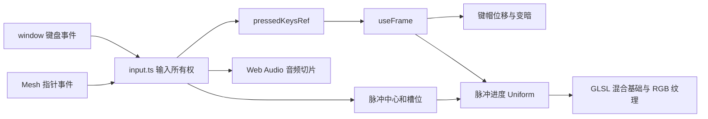
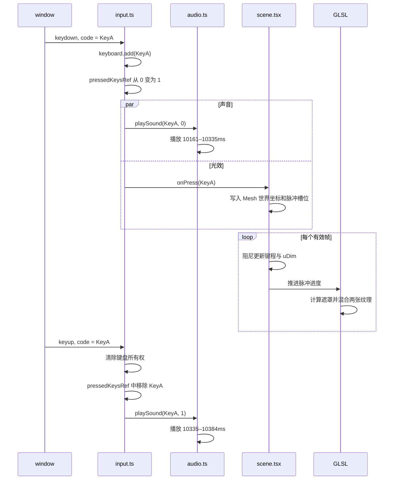

# Raycast 键盘交互实现拆解：从资源协议到实时反馈管线

这篇文章记录 Raycast 键盘交互的实现原理、调参入口和排错方法。初稿基于 2026-08-29 的源码，输入、音频、首帧显示和文件索引已在 2026-10-09 按当前仓库更新。本文主要讨论 `/raycast`；雾透和 Air75 工作台各自保留独立素材与校准参数。

文章讨论的是“如何深入学习并重建一个 3D 产品 Hero”，不涉及机器学习。涉及原作的结论来自公开产品页和制作文章；涉及参数、边界与风险的结论以当前仓库为准。文件链接不写行号，避免格式化或重构后失效。

## 开发时先查这里

| 你要处理的问题             | 先看文件                                                                                                                             | 本文位置               |
| -------------------------- | ------------------------------------------------------------------------------------------------------------------------------------ | ---------------------- |
| 实体键盘、鼠标拖键、卡键   | [`input.ts`](../src/components/shared/input.ts)                                                                                    | 输入所有权状态机       |
| 键帽下沉方向、键程和回弹   | [`scene.tsx`](../src/components/raycast/scene.tsx)、[`scene-config.ts`](../src/components/raycast/scene-config.ts)                 | 键帽如何模拟机械键程   |
| RGB 范围、速度、边缘和亮度 | [`shaders.ts`](../src/components/shared/shaders.ts)、[`scene-config.ts`](../src/components/raycast/scene-config.ts)               | RGB 扩散如何计算       |
| 雾透 UV 导入与扩散波纹 | [`keyboard-profile.ts`](../src/components/mist/keyboard-profile.ts)、[`import-model.ts`](../src/components/mist/import-model.ts) | [Mist 技术入口](#mist-技术入口2026-10-12) |
| 某个键没有声音             | [`audio.ts`](../src/components/shared/audio.ts)、[`sound-map.ts`](../src/components/shared/sound-map.ts)                         | 音频精灵如何播放       |
| 桌面首屏闪跳、Canvas 空白  | [`hero.tsx`](../src/components/raycast/hero.tsx)、[`scene-error-boundary.tsx`](../src/components/shared/scene-error-boundary.tsx) | Next.js 装载与降级     |
| 移动端不应下载 3D 场景     | [`hero.tsx`](../src/components/raycast/hero.tsx)                                                                                    | 1000/1001px 分支       |
| 调试当前场景参数           | [`debug.tsx`](../src/components/shared/debug.tsx)、[`scene-config.ts`](../src/components/raycast/scene-config.ts)                 | 开发配方：调按压与光效 |
| 提交前怎么验收             | [验证清单](#验证清单)、[`tests/`](../tests/) | 自动检查与浏览器检查 |

本地启动后，点击右上操作栏左侧的 Dialkit 原生入口即可展开调参面板。入口默认可见，面板默认折叠；确认参数后再把默认值写回配置文件。Air75 与 Mist 工作台使用同位置的设置按钮和抽屉内面板。

先把项目跑起来：

```bash
npm ci
npm run dev
```

浏览器打开 <http://localhost:3000>，把视口保持在 1001px 以上。先按一次实体键盘上的 A，再点击画面中的 A，最后按住鼠标拖过一排键。全文会沿着这三个输入解释同一条反馈链路。

### Mist 技术入口（2026-10-12）

`/nuphy-mist84` 默认展示用户提供的 1012 GLB 与 Base／RGB 两态 UV，设置抽屉保留「0923 UV」切换和本地导入。「雾透白灯」入口、五层 KTX2 加载、遮光属性与专用光学材质已移除。旧光学制作的测量和截图见[历史适配记录](mist-keyboard-adaptation.md)，不作为当前开发指南。雾透现已复用下文的 Raycast 双纹理扩散波纹，保留独立键位适配、静态结构 Base 外观及相机校准。

- [`hero.tsx`](../src/components/mist/hero.tsx) 管理素材套装、上传 URL 和舞台焦点。支持 GLB、Base UV、灯光 UV 单独替换，也支持多选或拖入一组文件；批量入口按 GLB 后缀和 Base／RGB／Light 文件名识别角色，无法判断时提示使用单张入口。未替换的文件使用当前套装内置素材，单个文件上限 50 MB，刷新后恢复默认。
- [`import-assets.ts`](../src/components/mist/import-assets.ts) 只接受对应内置路径及本地 blob URL，复用 GLB 容器和外链校验。失败、取消或部分加载成功时释放已加载资源。[`scene.tsx`](../src/components/mist/scene.tsx) 在新素材校验成功后替换预览，加载错误保留旧场景；旧资源在替换提交后释放。
- [`import-model.ts`](../src/components/mist/import-model.ts) 的 `prepareMistImportScene` 适配 1012 六行分组的 83 个键帽和 10 个静态结构网格，按横向顺序映射 `MIST_KEY_ROWS`。作者模型的键距为 19，转换为网页约 1.9 的键距，反转前后轴并用 Escape 对齐既有舞台；同步变换法线与三角绕序，保留 UV。0923 合并网格按完全相同 XYZ 连接 UV 断缝，再分离真实键帽。独立命名模型通过 `mapMistImportedKeyCodes` 验证 83 键，未知合并结构直接报错。
- [`keyboard-profile.ts`](../src/components/mist/keyboard-profile.ts) 的 `createMistUvMaterial` 使用 `sampler2D`，通过 Raycast 世界坐标波纹混合 Base／灯光外观；纹理为 `SRGBColorSpace`，默认 `flipY=false`，静态结构只显示 Base。键帽共享波纹中心与进度数组，每键仍独立压暗。UV 垂直翻转位于「UV 预览」分组，灯效贴图混合增益直接显示在面板中。
- [`ansi-renderer.tsx`](../src/components/shared/ansi-renderer.tsx) 继续管理键程、输入与首帧显示。Mist 不再覆盖 `onPress`，由共享渲染器创建扩散脉冲；profile 的 `advanceLight` 只同步减少动画模式和按键状态。

正常模式使用 Raycast 默认的 0.9 秒波纹、缓动指数 3 与贴图混合增益 2；雾透按键压暗比例默认 0，按下不额外变暗。雾透键距约 1.9，Raycast 约 0.19，波纹距离按十倍模型尺度换算，默认羽化宽度 0.8、最大半径 1.5。键程保留原校准值 0.16；0.25 会使 1012 帽内上层与静态轴体新增穿插。雾透两态贴图的混合比例限制在 0–1，增益 2 加速混合，但不向亮灯贴图之外外推颜色。旧视频参考下的半秒单键包络已移除。减少动画时灯效直接跟随按下与松开，不显示扩散。PNG 没有松开／压下两套光路，按键下沉不会重新计算折射；Base 同时含烘焙受光、印字和内部影像，不能称为实测 albedo 或恢复的油墨材质。

产品舞台默认使用从 `#D3E6F2` 到 `#ffffff` 的 180° 线性渐变，保留 400px 高度及既有相机投影。设置抽屉开关和背景调色不改变舞台占位；全局主题只改变导航、工具栏和 Dialkit。移动端默认使用匹配当前素材的静态回退，主动使用 UV 工作台后启用交互预览。场景完整加载并实际绘制首帧后才显示。`render-idle.webp` 是从当前 1012 场景导出的透明回退图，按 1200 × 400 的相机投影居中缩放；动态组件下载、素材解码和首帧等待期间持续显示。Canvas 首帧完成后，回退图在 0.5 秒内淡出，减少动画模式直接切换。首次加载失败时保留回退图，替换素材失败时保留旧场景。

[`scene-config.ts`](../src/components/mist/scene-config.ts) 集中保存内置素材与调参默认值。`MIST_1012_SOURCES` 指向 `public/assets/mist/keyboard-1012.glb`、`texture-base-1012.png`、`texture-light-1012.png`；`MIST_UV_SOURCES` 指向 `ux-0923/` 原素材。预设值 `1012` 为默认套装，`uv` 为 0923 套装。「页面背景颜色」使用 Dialkit 原生颜色控件，可作为两色线性渐变的起点；「背景渐变」分组提供开关、终点颜色与方向，默认开启。默认颜色、方向和开关均由配置提供。背景设置直接作用于页面 CSS，不重载模型。关闭抽屉后焦点回到舞台，实体按键继续可用。

旧 `public/assets/mist/mist-moonbow-bright-white.blend` 仅在本地保留为可编辑历史制作源，由 Git 忽略，也不进入 Sites 发布产物。仓库不再提供原自动重烘、导出脚本及制作中间文件；历史命令不能作为当前执行步骤。

雾透页面的 `createEasterEggInput` 位于 [`hero.tsx`](../src/components/mist/hero.tsx)。连续输入 `halloween` 或 `xmas` 会在新标签页打开 `https://youtu.be/MHIxAY98Bvg`，输入 `nuphy` 打开官网。识别忽略大小写，只保留最近九个英文字母；其他按键和失焦清空未完成序列，输入框、调参控件、组合快捷键与输入法组合输入不参与识别，长按重复事件忽略。跳转使用 `noopener,noreferrer`；原有按键灯效和声音仍由共享输入控制器处理。该监听器只随 Mist 页面挂载，Raycast 和 Air75 不启用。

## 项目从哪里开始

我第一次在 [The Raycast Keyboard 产品页](https://www.raycast.com/keyboard)看到这段 Hero。实体键盘或鼠标触发输入时，画面里的键帽同步下沉，机械键音随即播放，RGB 光从按键位置扩散。一次按键把模型、输入、声音和光效连在了一起。

随后，我读到 Raycast 设计工程师 Thomas Cullen 写的 [How the Raycast Keyboard landing page hero was made](https://x.com/thomasauros/status/2092977737837244583)。文章给出了原 Hero 的制作路径：

- 在 Blender 中精简约 2 MB 的模型，删除不朝向相机、最终不会进入镜头的几何；
- 用 `KeyboardEvent.code` 命名键帽 Mesh；
- 展开 UV，分别烘焙普通状态和 RGB 背光状态；
- 用 React Three Fiber 加载模型并处理输入；
- 为每个键录制按下、松开声音，再用 JSON 保存毫秒区间；
- 在自定义 TSL Shader 中按世界坐标计算扩张、淡出的圆形遮罩；
- 用 Dialkit 调参，并通过 Konami Code 打开面板。

原作者还提到，他用 Codex 分析录音、生成毫秒映射并清除切片间空白，约半小时完成音频整理。这是原作者公开的资产制作流程；当前仓库使用整理后的音频精灵和时间表，没有把这一步描述成由本项目重新完成。

这些资料说明了资产与交互之间的接口，没有公开完整生产源码。当前工程使用 Next.js、TypeScript、Tailwind CSS 和 GLSL，并处理服务端渲染边界、首帧握手、输入目标过滤、离屏暂停和局部错误回退。原作文章使用 TSL，本项目使用 GLSL `ShaderMaterial`；下文不会把两者混写。

项目范围也很明确：复刻导航与 Keyboard Hero，学习实时交互的工程组织。完整产品页、购买流程、键盘固件和真实硬件通信不在本仓库中。

## 先看完整反馈链路

键盘交互可以拆成一条实时反馈管线。输入层决定某个键是否处于按下状态；声音和脉冲只在“从未按下变为按下”的瞬间触发；渲染循环持续把状态变成键程、亮度和 Shader 进度。



代码按责任分成五层：

| 层       | 主要文件                               | 负责内容                               |
| -------- | -------------------------------------- | -------------------------------------- |
| 页面装载 | `hero.tsx`、`scene-error-boundary.tsx` | 断点、可视区、动态加载、首帧与错误降级 |
| 3D 场景  | `scene.tsx`、`scene-config.ts`         | 模型注册、相机、键程、渲染循环和调参   |
| 输入     | `input.ts`                             | 键盘与指针所有权、去重和异常清理       |
| 声音     | `audio.ts`、`sound-map.ts`             | OGG 加载、解码、切片选择和资源释放     |
| 光效     | `shaders.ts`、`constants.ts`           | 双纹理、脉冲数组与 GLSL 计算           |

React 管组件挂载、错误边界、媒体查询和低频 UI 状态。每帧都变化的数据放在 ref、Three 对象和 Shader uniform 中，避免按住多个键时让 React 组件树以帧率重渲染。

## 资源命名是一份接口协议

这类交互首先是资产工程。模型命名、浏览器键码和声音表只要有一处不一致，就会出现“点击有动画但实体键无效”或“键帽会动但没有对应声音”。

当前资源位于 `public/assets/`：

| 资源                   | 用途                             | 代码入口           |
| ---------------------- | -------------------------------- | ------------------ |
| `keyboard.glb`         | 键盘几何与 Mesh 名称             | `MODEL_URL`        |
| `texture-base.jpg`             | 未开启 RGB 时的烘焙外观          | `BASE_TEXTURE_URL` |
| `texture-rgb.jpg`              | 开启 RGB 后的烘焙外观            | `RGB_TEXTURE_URL`  |
| `key-sounds.ogg`       | 全部按下、松开录音组成的音频精灵 | `KEY_SOUND_URL`    |
| `render-idle.webp` | 移动端和 3D 失败时的静态替代     | `hero.tsx`         |

对当前 GLB 的直接检查得到以下结果：

- 文件内部有 176 个 Mesh 节点；
- 当前场景根级共有 85 个 Mesh，`scene.tsx` 只注册这一层；
- 根级包含 1 个名为 `static` 的底座和 84 个可指针交互对象；
- 64 个根级名称与 `sound-map.ts` 精确相交；
- 另外 20 个名称是 `keys.*`，可以被鼠标命中，但实体键盘不会产生这种 `event.code`；
- 声音表有 83 组切片，其中 19 个名称没有出现在当前根级 Mesh 中。

这些数字描述的是当前资产快照，并非键盘项目的固定规则。更换 GLB 后，应重新检查根层级、Mesh 名称和声音表交集。

### 为什么优先使用 `KeyboardEvent.code`

`event.key` 表示用户实际输入的字符，会受键盘布局和修饰键影响；`event.code` 更接近物理按键位置，例如 `KeyA`、`Digit1`、`Space`。让 Mesh 直接使用这些名称，输入层可以用一次集合查询和一次 Map 查询完成路由：

```text
KeyboardEvent.code
  → supportedKeys.has(code)
  → meshByName.get(code)
  → pressedKeysRef / sound-map / pulse center
```

代价是模型导出规范升级为正式接口。Blender 命名一旦漂移，TypeScript 不会在编译阶段报错，需要资产审计或运行时检查补位。

## 一次 `KeyA` 按下经历了什么

### 场景先完成首帧握手

`Hero` 在服务端和水合初始阶段都把桌面判断设为 `false`。浏览器确认宽度达到 1001px 后，才渲染 `next/dynamic` 引入的 `Scene`。桌面舞台从一开始就保留 400px 高度，场景未就绪时只保持透明，不拿另一张尺寸不同的图临时顶替。

`Scene` 中的 `Suspense` 等待 GLB 和两张纹理。`KeyboardModel` 在网格第一次实际完成绘制时，通过 `onAfterRender` 调用 `onFirstFrame`，随后：

1. `renderReady` 变为 `true`；
2. `Scene` 将 `aria-busy` 设为 `false`，舞台 CSS 据此显示背景和 Canvas；
3. 输入层从下一次渲染开始启用；
4. `aria-busy` 结束。

这一步很重要。模型请求完成不代表浏览器已经绘制出有效帧，直接在资源 Promise 完成后显示 Canvas 仍可能看到黑帧或相机跳变。

### 按下与松开的时序



浏览器长按会不断发送 `keydown`，但 `press` 会先检查 `pressedKeysRef`。只要键仍处于按下状态，重复事件不会再次播放声音或创建脉冲。

## 输入所有权状态机

鼠标和实体键盘可能同时按住同一枚键。如果只维护一个布尔值，任意一方先松手都会让键帽提前弹起。当前实现把“谁正在占用”与“最终是否按下”分开保存。

`createKeyboardInput` 把输入状态保存在一个控制器内，`useKeyboardInput` 负责浏览器订阅和清理：

| 控制器数据 | 含义 |
| --- | --- |
| `keyboard` | 当前由实体键盘占用的键集合 |
| `pressed` | 最终按下集合，通过 `pressedKeysRef.current` 提供给渲染层 |
| `pointerKey` | 单个拖动手势当前命中的键 |
| `dragging` | 是否仍处于主按钮拖动状态 |

状态规则可以写成：

```text
pressed(code) = keyboardOwns(code) OR pointerOwns(code)
```

`press(code)` 只处理第一次进入按下状态：写入 `pressedKeysRef`、播放按下音、创建脉冲。释放某个输入源时，调用方会先检查另一输入源是否仍持有该键；只有所有权归零，`release(code)` 才移除最终状态并播放松开音。

### 实体键盘路径

`keydown` 依次完成四个判断：场景已启用、目标不是交互控件、GLB 支持该键码、当前键尚未按下。`keyup` 先清除键盘所有权；如果指针仍占用同一个键，就保留 `pressedKeysRef`。

输入层有意不调用 `preventDefault()`。焦点位于普通页面内容时，方向键与 Space 可以触发键盘反馈，同时保留页面滚动。链接、按钮、表单控件、`contenteditable`、`role="button"` 和 `role="link"` 会被过滤，原生操作不受影响。

`useEventListener` 和 `useEventCallback` 来自 `usehooks-ts`。前者管理浏览器事件订阅，后者让稳定的控制器调用最新的声音、按下和松开回调。参数面板触发 React 重渲染时，不会重建输入所有权集合。

### 指针拖键路径

按下鼠标主键后，`onPointerMove` 和 `onPointerOver` 都会检查当前命中的 Mesh：

1. 命中与上一次相同的键时直接返回；
2. 进入另一枚可交互键时，先撤销旧键的指针所有权；
3. 如果实体键盘没有按住旧键，旧键释放；
4. 新键获得指针所有权并触发一次 `press`。

窗口级 `pointerup` 和 `pointercancel` 会释放指针当前持有的键，因此在 Canvas 外松手也能收尾。

当前没有 `onPointerOut` 路径。指针从键帽移到 `static` 底座或空白区域时，旧键不会当场释放；它会保持到指针进入下一枚可交互键，或窗口收到 `pointerup` / `pointercancel`。如果希望拖出键帽就回弹，需要补充离开命中区域的状态转移。

当前实现只保存一个 `pointerKey`，没有按 `pointerId` 分配独立状态。桌面鼠标足够使用，多点触控可能互相覆盖。如果产品要支持多指演奏，应改成 `Map<pointerId, code>`，并分别处理每个指针的结束事件。

### 卡键清理

有三类事件可能让正常的 `keyup` 或 `pointerup` 丢失：

- 窗口失焦；
- 页面进入后台；
- macOS 按住 Command 时，浏览器漏掉其他键的 `keyup`。

`blur`、`visibilitychange` 和组件卸载都会调用 `releaseAll()`。释放 Meta 键时，控制器的 `keyUp()` 会撤销所有非修饰键的键盘所有权，同时保留仍被指针占用的键。

当 `enabled=false` 时，`usehooks-ts` 管理的窗口监听仍然存在；各 handler 会提前返回，effect 同时清空已有所有权。Mesh 的 `pointerEvents` 变为空对象。这里的行为是“忽略新输入并清状态”，不是“卸载全部事件监听”。

## 键帽如何模拟机械键程

键盘每一排通常带有不同倾角，世界坐标的 `-Y` 不能代表所有键帽自身的下压方向。注册 Mesh 时，代码把局部向下向量旋转到父级坐标系：

```ts
pressAxis: LOCAL_PRESS_AXIS.clone().applyQuaternion(child.quaternion)
```

其中 `LOCAL_PRESS_AXIS = (0, -1, 0)`。每帧位置都从 `rest` 重新计算，避免连续累加造成漂移：

```ts
mesh.object.position
  .copy(mesh.rest)
  .addScaledVector(mesh.pressAxis, mesh.depth)
```

### 阻尼而非线性插值

目标键程只有两个值：按下时为 `controls['按压深度（模型单位）']`，松开时为 0。实际深度用 Three.js 的帧率无关阻尼逼近目标：

```ts
mesh.depth = THREE.MathUtils.damp(
  mesh.depth,
  targetDepth,
  controls["高级"]["按键收敛速率（s⁻¹）"],
  delta,
)
```

`delta` 先被限制为 `MAX_FRAME_DELTA = 1 / 30`。标签页从后台恢复时，即使真实帧间隔很大，键帽和光效也不会一步跳到结束状态。

当前默认值：

| 参数                | 默认值  | 作用                     |
| ------------------- | ------- | ------------------------ |
| `按压深度（模型单位）` | `0.025` | 最大键程 |
| `高级 / 按键收敛速率（s⁻¹）` | `55` | 接近目标的速度 |
| `按键压暗比例` | `0.4` | 到达最大键程时的变暗幅度 |

以下公式用 `keyPressDepth` 和 `pressedKeyDimming` 简写对应参数；源码和 Dialkit 使用上表中的中文名称。亮度按键程比例计算：

```text
pressedAmount = clamp(depth / keyPressDepth, 0, 1)
uDim = 1 - pressedAmount × pressedKeyDimming
```

位移和亮度共享同一个 `depth`，视觉不会出现键帽已经弹起、阴影还停留在按下状态的错位。

## RGB 扩散如何在 GPU 中计算

### 两张烘焙纹理

场景没有为每个键创建动态彩灯。`texture-base.jpg` 保存普通外观，`texture-rgb.jpg` 保存开启背光后的外观。Shader 在每个片元上决定两张图的混合比例。

纹理加载后统一设置：

- `flipY = false`，匹配 glTF UV 方向；
- `colorSpace = THREE.SRGBColorSpace`，按颜色纹理解码；
- `anisotropy = 8`，改善倾斜键盘表面的采样。

如果模型突然变黑、上下颠倒或颜色发灰，先检查这三个配置，再查 Shader 数学。

### 固定 10 个脉冲槽位

每次按下时，`triggerPulse` 获取键帽原点的世界坐标，把 XZ 写入当前槽位，再将该槽进度重置为 0。游标按环形缓冲区前进：

```text
slot = cursor
center[slot] = mesh world position.xz
progress[slot] = 0
cursor = (cursor + 1) mod 10
```

每帧由 CPU 推进进度：

```text
progress = min(1, progress + delta / pulseDuration)
```

`pulseDuration` 属于 CPU 更新逻辑，不是 Shader uniform。其余半径、羽化、缓动强度和亮度通过共享 uniform 更新。快速触发超过 10 次时，最早的脉冲会被覆盖；这个上限让 Shader 循环成本保持固定。

### 片元公式

每个片元对 10 个槽位执行相同计算。以当前默认参数表示：

```text
progress = clamp(progress, 0, 1)
eased = 1 - (1 - progress) ^ 3
radius = mix(0, 0.15, eased)
distance = length(fragmentWorldXZ - center)
disc = 1 - smoothstep(radius, radius + 0.08, distance)
fade = 1 - eased
pulse = max(pulse, disc × fade)
```

这里生成的是带柔边的扩张圆盘，并随年龄淡出。多个脉冲使用 `max` 合并，而不是求和；重叠区域保持最强脉冲亮度，不会因为十次连按直接累加成白块。

最终颜色：

```text
pulseLight = pulse × lightingIntensity
lightingMix = mix(pulseLight, lightingIntensity, defaultLighting)
color = mix(baseColor, rgbColor, lightingMix) × uDim
```

`lightingIntensity` 默认是 2，所以 `mix` 可能进行外插而不只是在 0 到 1 之间插值。这是当前视觉调参的一部分。如果更换纹理后出现过曝，先查纹理、`lightingIntensity` 和 `mix` 外插；当前材质设为 `toneMapped = false`，tone mapping 不是这条路径的变量，只有重新启用后才需要纳入排查。

### 为什么每个键有独立材质

所有材质共享基础纹理、RGB 纹理、脉冲中心和脉冲进度的 uniform 对象；每个可交互键只保留独立的 `uDim`。这样一个脉冲可以照亮整个键盘，同时某枚按下的键可以单独变暗。

`useMemo` 在这里用于稳定 uniforms、Mesh 状态和材质实例，避免普通 React 重渲染重复创建 GPU 对象。资源释放由单独的 effect cleanup 完成：卸载 `KeyboardModel` 时遍历材质并调用 `dispose()`。创建稳定与拥有释放责任是两件事，不应把 `useMemo` 本身描述成资源所有者。

## 音频精灵如何播放

为 83 个键分别请求两个小音频文件，会增加请求数量、解码次数和管理成本。当前项目把所有按下、松开录音串成一个 `key-sounds.ogg`，`sound-map.ts` 保存毫秒区间：

```ts
KeyA: [
  [10161, 10335], // press
  [10335, 10384], // release
]
```

播放时创建新的 `AudioBufferSourceNode`，从共享 `AudioBuffer` 的指定 offset 开始，只播放这段 duration。多个 Source 可以并发，因此多键输入不会互相截断。

切片选择顺序：

1. 精确查找 `KEY_SOUND_MAP[code]`；
2. 查找 `SOUND_KEY_ALIASES`，例如右 Control 借用左 Control；
3. 仍未命中时，随机借用一组字母键声音。

第三步让 `keys.*` 这类可点击但未单独命名的 Mesh 仍有反馈，也避免所有缺失键重复同一个采样。按下和松开会分别调用 `playSound`，因此会独立随机选择字母切片；同一枚无映射键的 press 与 release 不保证来自同一组录音。如果要成对保持手感，可以在 press 时缓存 fallback 键码，release 时复用。

### Web Audio 生命周期

`useKeyAudio` 只持有一个播放器引用。挂载时，`createKeyAudioPlayer` 创建 `AudioContext`、Gain、下载请求和活动音源集合；播放器自行管理解码 Buffer 与销毁标记。首次有效播放时，如果 Context 仍是 `suspended`，会先调用 `resume()`，成功后再播放。

组件卸载时会：

- 中止仍在进行的 fetch；
- 停止并断开全部 Source；
- 清空已解码 Buffer；
- 断开 Gain；
- 关闭 AudioContext。

销毁操作可重复调用。若 `resume()` 在销毁后才成功，播放器会检查 `disposed`，不会创建新音源；晚到的解码结果也不会重新写入 Buffer。

当前有两个需要保留在排错清单里的事实：音频尚未解码时，播放请求会直接返回，所以冷启动后的第一次按键可能无声；Gain 固定为 3，多键高频输入存在响度过高或削波风险。加载、解码和 `resume()` 错误目前被静默处理，排查无声问题时需要临时加入开发日志或浏览器断点。

## Next.js 装载、响应式与失败路径

### 1000/1001px 双分支

`Hero` 同时提供两套视觉路径：

- 1000px 及以下显示 `render-idle.webp`；
- 1001px 及以上才挂载动态导入的 `Scene`。

CSS 负责最终显示状态，`useMediaQuery` 决定是否创建 3D 组件。两层判断缺一不可：只用 CSS 隐藏 Canvas 仍会下载和初始化 Three.js；只用 JavaScript 分支则可能在 SSR、水合和断点切换时出现几何抖动。

`useMediaQuery` 使用 `defaultValue: false` 与 `initializeWithValue: false`。服务端不会猜测桌面宽度，水合首帧也保持一致。桌面端静态分支由 Tailwind 在 1001px 隐藏，因此不会先显示大图再换模型。

### 首帧、错误和重进桌面

桌面舞台通过 CSS `:has([aria-busy="false"])` 判断是否可以显示。成功路径由 `Scene` 唯一的 `renderReady` 状态驱动，网格 `onAfterRender` 才报告首帧；失败路径由局部 `SceneErrorBoundary` 显示带有同一就绪标记的静态图。两条路径使用同一个 400px 舞台。

窗口缩到移动端时，整个 `DesktopStage` 连同场景和错误边界卸载。再次回到桌面时重新挂载，自然得到新的首帧状态；Hero 不再保存重复的就绪、失败标记，也不需要断点 reset effect。

### 离屏与视频弹窗

`Hero` 把 `inView && !videoOpen` 传给 `Scene.active`。停用后：

- 输入 handler 忽略新事件，并清空已有按键；
- Mesh 不绑定指针处理；
- 相机停止更新；
- 首帧完成后的 Canvas 切换为 `frameloop="demand"`。

音频 Buffer 仍保留，因为 Scene 没有卸载。脉冲进度也停在当前值；重新激活后从原进度继续。这是“暂停”，不是“重置”。

### 减少动态效果

`prefers-reduced-motion` 开启后，CSS 入场动画停止，相机直接放到目标位置。按键反馈仍保留，因为它承担功能性响应；项目没有把减少动态效果理解成关闭全部交互。

## React、渲染循环与 Hook 的边界

状态放在哪里，取决于谁需要观察它，而不是“凡是变化都放 React state”。

| 数据                                     | 保存方式          | 原因                             |
| ---------------------------------------- | ----------------- | -------------------------------- |
| `videoOpen`、Scene 的 `renderReady` | React state | 改变组件树或 ARIA 状态 |
| 媒体查询、可视区                         | `usehooks-ts`     | 通用浏览器订阅，影响低频装载决策 |
| 当前输入所有权 | 控制器内部的集合和字段 | 高频、命令式，渲染循环直接读取 |
| 每键深度、Three 对象                     | 普通对象/ref      | 每帧更新，不需要 React 重渲染    |
| 脉冲中心与进度                           | Shader uniform    | GPU 每片元读取                   |
| Dialkit 参数                             | `useDialKit` 结果 | 调参变化再同步到 CPU 或 uniform  |

项目没有为 `useMediaQuery`、`useEventListener` 或 `useIntersectionObserver` 再包一层同义 Hook；这些通用能力直接来自 `usehooks-ts`。`useKeyboardInput` 和 `useKeyAudio` 继续保留，因为它们封装的是输入所有权协议和 Web Audio 资源生命周期，删除后只会把领域逻辑散回组件。

样式也遵循相同边界。`globals.css` 保留主题变量、命名关键帧和已说明原因的 Dialkit 兼容规则；组件状态和响应式样式写在 Tailwind class 中。条件类与超过 150 字符的 `className` 使用共享 `cn()`，长类按布局、视觉和交互分段。

## 开发配方

### 增加一个实体键盘可响应键

按这个顺序检查：

1. 在 GLB 根层加入 Mesh，并把名称设为浏览器的 `KeyboardEvent.code`；
2. 确认名称不是 `static`，也没有与其他根 Mesh 重复；
3. 在 `sound-map.ts` 添加按下、松开切片，或明确接受别名/随机字母回退；
4. 本地同时测试实体键盘、鼠标点击和两种输入共同占用；
5. 检查脉冲中心是否位于键帽视觉中心。

如果新键位于嵌套 Group 中，当前 `scene.children` 不会注册它。需要先完成“支持嵌套模型层级”的改造。

### 调整按压手感

打开 Dialkit，在 `scene-config.ts` 定义的范围内一起观察：

- `按压深度（模型单位）`：移动距离；
- `高级 / 按键收敛速率（s⁻¹）`：按下与回弹速度；
- `按键压暗比例`：最大键程时的变暗程度。

键程增大但阻尼不变时，运动通常会显得更慢。确认参数后再改默认值，不要把调试面板当成持久配置来源。

### 调整 RGB 光效

| Dialkit 参数 | 公式简写 | 位置与作用 |
| --- | --- | --- |
| `波纹时长（s）` | `pulseDuration` | CPU 更新脉冲寿命 |
| `波纹最大半径（场景单位）` | `pulseRadius` | Shader uniform，控制最大半径 |
| `波纹羽化宽度（场景单位）` | `pulseFeather` | Shader uniform，控制边缘宽度 |
| `波纹缓动指数` | `pulseEasingStrength` | Shader uniform，控制扩张节奏 |
| `灯效贴图混合增益` | `lightingIntensity` | Shader uniform，控制 RGB 混合强度 |
| `常亮权重` | `defaultLighting` | Shader uniform，控制常驻背光比例 |

先用 Dialkit 确定组合，再修改 `scene-config.ts` 或 `constants.ts` 的默认值。仅调整视觉参数不需要改 GLSL 结构。

### 更换或补充声音

先在音频编辑器中记录新的毫秒起止点，再更新 `sound-map.ts`。需要分别保留 press 与 release，两段不能重叠到邻近键。改完后至少测试：单击、长按、快速连按、多键并发和 Context 从 suspended 恢复后的第一次播放。

### 在弹窗或其他覆盖层打开时暂停场景

把覆盖层状态并入传给 `Scene.active` 的条件即可。停用会清理输入并暂停帧循环，但不会释放音频和模型。如果覆盖层长期存在且需要回收显存，应选择卸载 `Scene`，并接受重新装载成本。

### 支持嵌套 GLB

将根级循环替换为 `scene.traverse()` 只是第一步，还要回答：

- Mesh 的 `position` 与 `quaternion` 属于哪一级局部坐标；
- 重新挂到新 `<group>` 后如何保留父级变换；
- 同名 Mesh 怎么处理；
- 哪些几何和材质由缓存拥有，哪些由组件释放；
- 脉冲中心使用对象原点还是包围盒中心。

若不处理父级变换，键帽位置和按压方向会在“成功注册”后悄悄出错。

## 排错表

| 现象                         | 先检查                                             | 常见原因                                        |
| ---------------------------- | -------------------------------------------------- | ----------------------------------------------- |
| 鼠标点击有效，实体键无效     | GLB 根级 Mesh 名、`supportedKeys`                  | 名称是 `keys.*`、大小写不符或 Mesh 在嵌套 Group |
| 键帽会动但没有声音           | `sound-map.ts`、Audio Buffer、Context state        | 切片缺失、尚未解码、`resume()` 失败             |
| 第一次按键无声，之后正常     | 播放器 `buffer` 何时写入                               | 用户输入早于 fetch 与 decode 完成               |
| 声音过响或爆音               | Gain、并发 Source、源文件峰值                      | Gain 固定为 3，多键录音叠加                     |
| 键帽按下方向倾斜或横移       | Mesh quaternion、局部轴、父级变换                  | 模型轴向或层级变化                              |
| 松手后仍有键按住             | `pointerup`、`blur`、`visibilitychange`、Meta 路径 | 结束事件丢失或多指覆盖单一 `pointerKey`      |
| RGB 光斑偏离键帽             | Mesh 原点与世界 XZ                                 | 原点不在视觉中心或层级变换错误                  |
| RGB 纹理颠倒、发灰           | `flipY`、`colorSpace`、UV                          | 纹理配置遗漏或资产 UV 变化                      |
| 连按后早期光效消失           | `MAX_PULSES` 与环形游标                            | 超过 10 个槽位后按设计覆盖                      |
| 桌面出现静态图换小模型的跳动 | 固定舞台、`renderReady`、断点 class                 | 首帧前显示了尺寸不一致的 fallback               |
| 桌面舞台一直透明             | `onFirstFrame`、资源请求、Error Boundary           | Canvas 没有产生有效帧，失败状态也未上报         |
| 移动端仍下载 Three.js        | dynamic import 的 JSX 条件                         | 只用 CSS 隐藏，没有阻止 Scene 挂载              |
| 打开视频后 GPU 仍持续刷新    | `active`、`inView`、`frameloop`                    | 覆盖层状态没有传入场景                          |

## 性能与已知边界

| 当前策略或边界                   | 结果                                                              |
| -------------------------------- | ----------------------------------------------------------------- |
| 桌面端动态加载 Scene             | 移动端不主动创建 3D 场景，但需维护静态与动态两套视觉路径          |
| `dpr={[1, 1.75]}`                | 高分屏更清晰，同时限制填充成本                                    |
| 最多 10 个脉冲                   | Shader 循环成本固定，极快连按会覆盖旧脉冲                         |
| `MAX_FRAME_DELTA`                | 后台恢复时动画不跳帧，隐藏期间相当于暂停时间                      |
| 84 个可交互根 Mesh、每键独立材质 | `uDim` 简单直接，但绘制调用和材质数量较高                         |
| 每个可见片元固定检查 10 个脉冲   | 计算可预测；可见但空闲时仍有 GPU 成本                             |
| 场景可见时使用持续帧循环         | 相机、按键和脉冲平滑；完全空闲时仍持续渲染                        |
| 离屏或视频打开后使用 demand      | 停止无意义刷新；未结束动画会停在当前进度                          |
| 音频精灵                         | 每次 Scene 挂载只请求一个文件并解码一次；时间表必须严格匹配源文件 |
| 只遍历 `scene.children`          | 当前根层资产可用；嵌套 Mesh 无法注册                              |
| 单一 `pointerKey`             | 鼠标拖键简单；多点触控不完整                                      |
| Canvas 整体为 `role="img"`       | 辅助技术能理解场景主题，但不能逐键聚焦 3D Mesh                    |

目前最值得量化的性能项是桌面空闲时的持续 GPU 成本。若后续页面内容变长，可以在“没有相机动画、按键动画或活跃脉冲”时进一步切换 demand，并在新输入时调用 `invalidate()`。这项改造需要先定义完整的活动状态，避免光效中途停止。

## 验证清单

### 自动检查

```bash
npm run lint
npm run typecheck
npm run build
npm test
```

`npm test` 使用 Vitest 运行全仓测试，其中 Sites 用例依赖构建生成的 `dist/`。只检查部署契约时可运行 `npm run test:sites`，同样需要先构建。

### 输入

- 长按字母键，确认 key repeat 不会重复创建声音和脉冲；
- 键盘与鼠标同时按同一键，交换松开顺序；
- 按住鼠标拖过多键，并在 Canvas 外松手；
- 按住多个键后切换标签页，返回后检查卡键；
- 在 macOS 测试 Command 组合键；
- 分别聚焦链接、按钮、input、textarea、select 和 contenteditable；
- 确认输入层未拦截方向键和 Space 的默认行为；具体页面是否可滚动由其布局决定。

### 装载与响应式

- 慢速网络下观察 400px 桌面舞台是否稳定；
- 分别检查 1000px 与 1001px；
- 桌面缩到移动端后再放回，确认场景重新完成首帧握手；
- 强制 GLB 或纹理 404，确认局部静态图出现；
- 打开 `prefers-reduced-motion`，确认相机直接就位；
- 把场景滚出视口或打开视频，确认输入与持续帧循环停用。

### 图形与声音

- 快速触发超过 10 次，观察环形缓冲区覆盖；
- 检查不同键盘排的按压方向；
- 冷启动后立即按键，记录首音是否丢失；
- 多键连按时观察响度峰值；
- 卸载 Scene 后检查 AudioContext、Source 与材质是否释放。

## 推荐阅读顺序

如果第一次进入项目，按以下顺序阅读：

1. [`hero.tsx`](../src/components/raycast/hero.tsx)：从页面生命周期理解断点、首帧和降级；
2. [`input.ts`](../src/components/shared/input.ts)：理解所有权集合和异常清理；
3. [`scene.tsx`](../src/components/raycast/scene.tsx)：连接模型注册、输入、逐帧动画与 Shader；
4. [`shaders.ts`](../src/components/shared/shaders.ts)：对照公式阅读 uniform 和 GLSL；
5. [`audio.ts`](../src/components/shared/audio.ts)：理解音频精灵与清理；
6. [`scene-config.ts`](../src/components/raycast/scene-config.ts)、[`constants.ts`](../src/components/shared/constants.ts)、[`sound-map.ts`](../src/components/shared/sound-map.ts)：核对参数和数据；
7. [`debug.tsx`](../src/components/shared/debug.tsx)：查看 Dialkit 原生入口与全局主题如何衔接。
8. [`scene-animation.ts`](../src/components/shared/scene-animation.ts)：查看共享的脉冲推进、uniform 更新与窄画幅计算。

## TSL 与 GLSL：同一套光效的两条实现路径

原作文章说的 TSL 和当前项目的 GLSL 不是两种不同的光效算法。它们可以表达同一套脉冲公式，区别在于开发者如何描述 Shader，以及 Three.js 用哪条渲染管线把它交给 GPU。

当前生产代码仍是 [`shaders.ts`](../src/components/shared/shaders.ts) 中的 GLSL `ShaderMaterial`。本章后半部的 TSL 是可供迁移实验的等价骨架，示例在编写时通过 Three.js r185 类型检查，但没有接入当前页面；后续修改不会由现有业务测试自动验证这段示例。

### 先分清“语言”和“生成器”

GLSL 是 GPU Shader 语言。项目把顶点和片元源码作为字符串交给 `ShaderMaterial`，`WebGLRenderer` 再让浏览器的 WebGL 实现编译、链接并执行。

TSL（Three.js Shading Language）是写在 JavaScript/TypeScript 里的节点 API。`Fn`、`mix`、`uniform`、`texture` 这些调用先构建一张节点图，`NodeBuilder` 再经过 setup、analyze 和 generate 阶段，为当前后端生成 WGSL 或 GLSL。`Fn` 中的算子不是由 JavaScript 在 CPU 上逐片元运行；JavaScript 只负责建图，生成后的 Shader 仍在 GPU 上执行。

```text
GLSL 路径
TypeScript 状态 → uniform / varying → GLSL 字符串
  → WebGLRenderer → WebGL 程序 → GPU

TSL 路径
TypeScript 状态 → uniform node / node graph → NodeBuilder
  → WGSL 或 GLSL → WebGPURenderer 后端 → GPU
```

Three.js 的 [`ShaderMaterial`](https://threejs.org/docs/pages/ShaderMaterial.html) 文档明确将它限定在 `WebGLRenderer`。[`WebGPURenderer`](https://threejs.org/manual/en/webgpurenderer) 不支持 `ShaderMaterial`、`RawShaderMaterial` 和 `onBeforeCompile()`；转到这条渲染器路径时，自定义材质应改用 Node Material 和 TSL。

### 两种写法的工程差异

| 对比项       | 当前 GLSL `ShaderMaterial`                  | TSL + Node Material                              |
| ------------ | ------------------------------------------- | ------------------------------------------------ |
| 算法表达     | 顶点、片元 Shader 字符串                    | JavaScript/TypeScript 节点图                     |
| 产物         | WebGL 使用的 GLSL                           | 按后端生成 WGSL 或 GLSL                          |
| 渲染器       | `WebGLRenderer`                             | `WebGPURenderer`，可使用 WebGPU 或回退到 WebGL 2 |
| 世界坐标     | 手写 `modelMatrix`，再通过 varying 传入片元 | 直接使用 `positionWorld` 节点                    |
| uniform      | 手工声明 GLSL 类型与 JS `{ value }`         | `uniform()`、`uniformArray()` 节点               |
| 组合与复用   | GLSL 函数、字符串和 include                 | 普通模块、`Fn`、可组合节点                       |
| 类型错误     | 多在 Shader 编译时暴露                      | 建图时可捕捉一部分，后端编译仍可报错             |
| 输出颜色处理 | 当前手写 `colorspace_fragment` 片段         | Node Material 接入渲染器的颜色输出流程           |
| 调试         | 可直接对照完整 GLSL 源码                    | 需同时检查节点图与生成代码                       |

TSL 节点有更强的组合性，也能让同一套材质逻辑面向两种后端。GLSL 则更直接：当需求只是一段稳定、短小的 WebGL 材质时，可以很快对照最终 Shader 源码。TSL 不会自动让同一个算法更快，GLSL 也不等于维护性必然更差。

### 当前 GLSL 实现做了什么

[`shaders.ts`](../src/components/shared/shaders.ts) 有一段顶点 Shader 和一段片元 Shader。顶点阶段完成两件事：

```glsl
vUv = uv;
vec4 worldPosition = modelMatrix * vec4(position, 1.0);
vWorldXZ = worldPosition.xz;
gl_Position = projectionMatrix * viewMatrix * worldPosition;
```

`vWorldXZ` 会在三角形内插值，所以片元 Shader 能知道当前像素在键盘平面的世界 XZ 坐标。片元阶段再固定循环 10 次，比较当前位置与每个脉冲中心的距离，最后取最强遮罩去混合两张纹理。

两张纹理各采样一次，而不是在循环里重复采样。这一点对性能很重要：脉冲数会增加距离、`smoothstep` 和缓动计算，不会把纹理读取数乘上 10。

### 等价的 TSL 节点图

下面的骨架保留了当前设计：10 个共享脉冲槽、每键独立 `dim`、世界 XZ 距离和双纹理混合。如果要进行实验，可以先放入一个 kebab-case 模块，例如 `tsl-material.ts`：

```ts
import {
  float,
  Fn,
  Loop,
  max,
  mix,
  positionWorld,
  pow,
  smoothstep,
  texture,
  uniform,
  uniformArray,
  uv,
} from "three/tsl"
import * as THREE from "three/webgpu"

import {
  DEFAULT_LIGHTING,
  LIGHTING_INTENSITY,
  MAX_PULSES,
  PULSE_EASING_STRENGTH,
  PULSE_FEATHER,
  PULSE_RADIUS,
} from "./constants"

export function createKeyboardTslSharedNodes() {
  return {
    pulseCenters: uniformArray<"vec2">(
      Array.from({ length: MAX_PULSES }, () => new THREE.Vector2()),
      "vec2",
    ),
    pulseProgress: uniformArray<"float">(
      Array.from<number>({ length: MAX_PULSES }).fill(1),
      "float",
    ),
    defaultLighting: uniform(DEFAULT_LIGHTING),
    lightingIntensity: uniform(LIGHTING_INTENSITY),
    easingStrength: uniform(PULSE_EASING_STRENGTH),
    feather: uniform(PULSE_FEATHER),
    maxRadius: uniform(PULSE_RADIUS),
  }
}

type KeyboardTslSharedNodes = ReturnType<typeof createKeyboardTslSharedNodes>

export function createKeyboardTslMaterial(
  baseTexture: THREE.Texture,
  rgbTexture: THREE.Texture,
  shared: KeyboardTslSharedNodes,
) {
  const dim = uniform(1)

  const pulseMask = Fn(() => {
    const pulse = float(0).toVar("pulse")

    Loop(MAX_PULSES, ({ i }) => {
      const progress = shared.pulseProgress.element(i).clamp(0, 1).toVar()
      const eased = float(1)
        .sub(pow(float(1).sub(progress), shared.easingStrength))
        .toVar()
      const radius = mix(0, shared.maxRadius, eased).toVar()
      const distanceToPulse = positionWorld.xz
        .sub(shared.pulseCenters.element(i))
        .length()
        .toVar()
      const disc = float(1)
        .sub(smoothstep(radius, radius.add(shared.feather), distanceToPulse))
        .toVar()

      pulse.assign(max(pulse, disc.mul(float(1).sub(eased))))
    })

    return pulse
  })

  const pulseLight = pulseMask().mul(shared.lightingIntensity)
  const lightingMix = mix(
    pulseLight,
    shared.lightingIntensity,
    shared.defaultLighting,
  )
  const color = mix(
    texture(baseTexture, uv()).rgb,
    texture(rgbTexture, uv()).rgb,
    lightingMix,
  ).mul(dim)

  const material = new THREE.MeshBasicNodeMaterial()
  material.colorNode = color
  material.toneMapped = false

  return { material, dim }
}
```

这段代码与当前 GLSL 的对应关系是：

| GLSL                                       | TSL                                |
| ------------------------------------------ | ---------------------------------- |
| `varying vec2 vWorldXZ`                    | `positionWorld.xz`                 |
| `uniform vec2 uPulseCenters[10]`           | `uniformArray(..., "vec2")`        |
| `uniform float uPulseProgress[10]`         | `uniformArray(..., "float")`       |
| `for (int index = 0; index < 10; index++)` | `Loop(MAX_PULSES, ({ i }) => ...)` |
| 可修改的局部 `float pulse`                 | `float(0).toVar()` 与 `assign()`   |
| `texture2D(uBaseMap, vUv)`                 | `texture(baseTexture, uv())`       |
| `gl_FragColor = ...`                       | `material.colorNode = color`       |
| `#include <colorspace_fragment>`           | Node Material 的渲染器输出流程     |

`positionWorld` 让开发者不再手写 varying，但世界坐标计算没有消失，而是由节点系统按需生成。类似地，`Loop` 依然会生成 GPU 循环或等价结构；它不会把 10 次距离计算变成一次。

纹理配置也要保留。`texture-base.jpg` 和 `texture-rgb.jpg` 仍应设置 `flipY = false` 与 `SRGBColorSpace`。TSL 可以接管节点类型和输出链路，不会自动修正错误的 UV 或纹理色彩空间。

### CPU 更新逻辑不需要重写

输入所有权、环形游标、键程阻尼和 `pulseDuration` 都在 CPU 侧。迁移材质时，可以保留这些逻辑，只把 uniform 的读写换成节点值：

```ts
const pulseIndex = runtime.pulseCursor

shared.pulseCenters.array[pulseIndex].set(worldPosition.x, worldPosition.z)
shared.pulseProgress.array[pulseIndex] = 0

for (let index = 0; index < MAX_PULSES; index += 1) {
  const progress = shared.pulseProgress.array[index]
  shared.pulseProgress.array[index] = Math.min(
    1,
    progress + delta / controls["波纹时长（s）"],
  )
}

shared.lightingIntensity.value = controls["灯效贴图混合增益"]
keyMaterial.dim.value = 1 - pressedAmount * controls["按键压暗比例"]
```

`uniformArray` 会按渲染更新数组缓冲。每帧修改 `.array` 和 `.value` 即可，不要在 `useFrame` 里重建 `Fn`、节点图或材质。每个键仍需要独立的 `dim` uniform node，脉冲数组与光效参数则应共享。

### 迁移 TSL 时还要更换渲染器

React Three Fiber 的 [`Canvas`](https://r3f.docs.pmnd.rs/api/canvas) 默认创建 `WebGLRenderer`，这正是当前项目的路径。要让 Node Material 面向 WebGPU，需要用异步 `gl` 工厂初始化 `WebGPURenderer`：

```tsx
import { Canvas, extend } from "@react-three/fiber"
import * as THREE from "three/webgpu"

extend(THREE as never)

export function WebGpuScene() {
  return (
    <Canvas
      gl={async (props) => {
        const renderer = new THREE.WebGPURenderer(
          props as THREE.WebGPURendererParameters,
        )
        await renderer.init()
        return renderer
      }}
    >
      {/* 现有场景组件 */}
    </Canvas>
  )
}
```

这不是完整迁移的全部代码。实际落地时还要检查三件事：

1. 项目内的 Three.js 实例和类型必须保持一致，不要让 `three` 与 `three/webgpu` 对象在材质、场景和 loader 之间混用；
2. `WebGPURenderer.init()` 是异步的，首帧握手和 Error Boundary 要覆盖渲染器初始化失败，不只是 GLB 与纹理请求失败；
3. `WebGPURenderer` 的 WebGL 2 fallback 只是 GPU 后端回退，不能取代项目已有的移动端 WebP 和尺寸稳定的场景错误回退。

Three.js 当前仍将 `WebGPURenderer` 标为实验性渲染器。它会在不支持 WebGPU 时自动选用 WebGL 2，也可以通过 `forceWebGL` 为两种后端做对照测试。这种回退提高了可达性，不代表 WebGPU 路径与当前 WebGL 路径已经自动达到视觉和性能一致。

### 两条路径的性能上限由同一套数学决定

以这个项目为例，两种写法都要在每个可见片元上完成两次纹理采样和最多 10 组距离计算。繁忙时的主要成本来自屏幕覆盖面积、DPR、材质与绘制调用数，以及这段片元数学。把 GLSL 改写成 TSL 不会直接删除这些工作。

WebGPU 在更大的绘制调用量、计算任务或更复杂的资源管理中可能提供不同的上限，但 Three.js 官方指南也提醒，某些应用在 `WebGLRenderer` 下可能更快。这个 Hero 需要用实测回答，至少记录：

- 首次节点图与 pipeline 编译时间；
- 空闲、单键和快速连按时的 CPU/GPU frame time；
- DPR 1 和 1.75 下的帧率与显存占用；
- WebGPU 与 `forceWebGL` 的首帧、颜色、动画和错误路径差异。

### 什么时候值得迁移

继续使用当前 GLSL 更合适的情况：

- 项目只需要 WebGL 2，当前效果已稳定；
- 自定义 Shader 数量少，直接阅读完整 GLSL 更方便；
- 近期目标是调视觉参数和优化装载，而不是更换渲染后端。

考虑迁移到 TSL 的情况：

- 已确定要使用 WebGPU、WGSL 或 Three.js 的节点后处理；
- 多种材质需要复用同一组脉冲、颜色或噪声节点；
- 后续会增加计算 Shader 或同时维护 WebGPU/WebGL 2 后端。

迁移判断应该由后端目标、复用需求和实测结果驱动。如果只是认为 TSL 写法更新，为此更换渲染器会同时扩大首帧、材质、loader、类型和降级路径的验证范围。

### 一个风险可控的迁移顺序

1. 保留当前 GLSL 路径，用独立页面或开发 feature flag 创建 WebGPU 实验；
2. 只迁移键盘材质，复用 `input.ts`、音频、脉冲游标和键程计算；
3. 先固定两张纹理、相机、DPR 和所有 Dialkit 参数，再做同视口截图对比；
4. 分别验证 WebGPU 和 `forceWebGL`，覆盖 1000/1001px、冷启动、资源失败和 `prefers-reduced-motion`；
5. 记录首帧耗时、frame time 与显存，确认这次迁移有明确收益后再替换生产路径。

本章的 API 和渲染器边界可继续查阅 [Three.js TSL 规范](https://threejs.org/docs/TSL.html)、[WebGPURenderer 指南](https://threejs.org/manual/en/webgpurenderer)、[`ShaderMaterial` 文档](https://threejs.org/docs/pages/ShaderMaterial.html) 和 [React Three Fiber `Canvas` 文档](https://r3f.docs.pmnd.rs/api/canvas)。

## 结语

这次复刻最有价值的部分，是把模型、浏览器输入、音频表和 Shader 坐标统一成可检查的协议。协议稳定后，一次按键才能可靠地穿过输入、动画、声音和光效；协议不完整时，视觉再接近原站也会在扩展和排错阶段暴露问题。

实现中还需要守住两条边界：React 负责组件树与生命周期，渲染循环负责逐帧数据；桌面 3D 是增强体验，首帧、失败和移动端都必须保留尺寸稳定的可见内容。后续修改可以从本文开发索引进入，遇到异常按排错表定位，完成后再用验收清单复查。

> 品牌、3D 模型、纹理、静态渲染和音频素材仅用于技术学习。公开分发或商业使用前，需要单独确认授权范围。
