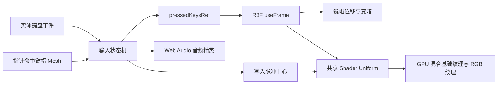
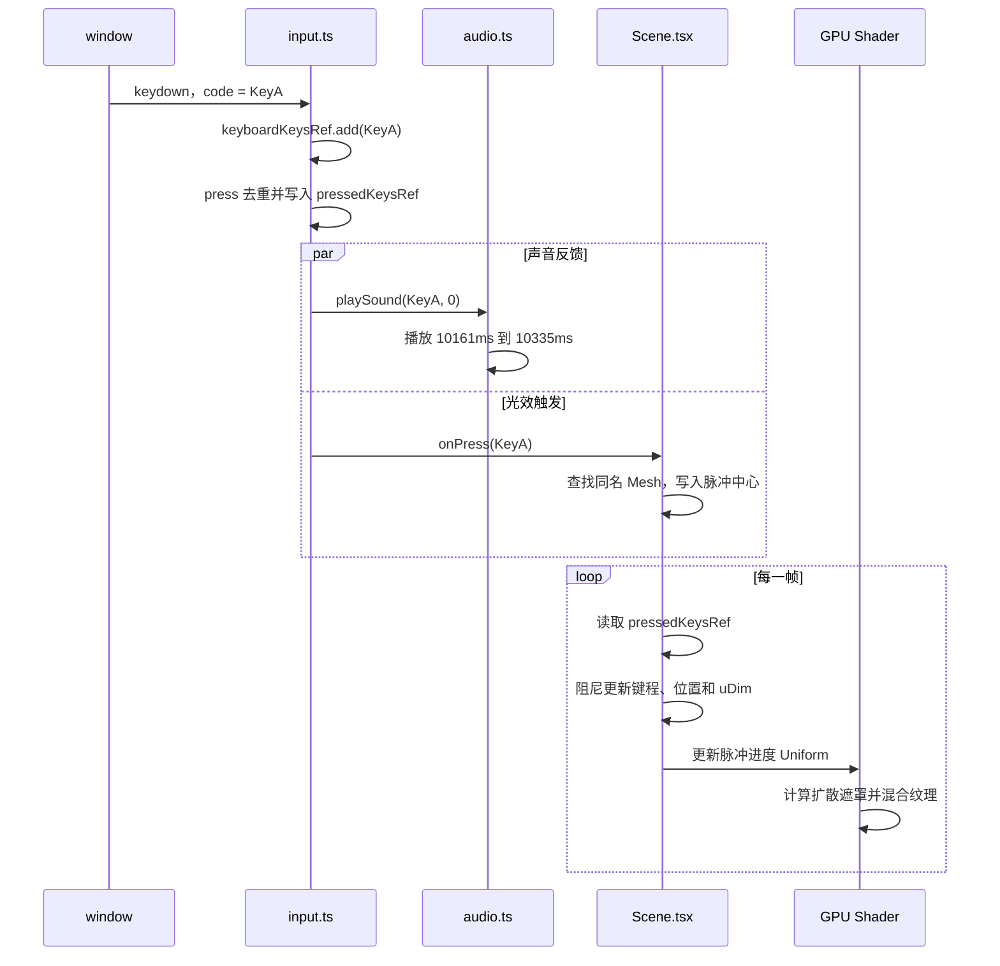

# Raycast 键盘交互实现拆解

> 本文基于提交 `3742c89` 的源码，面向希望学习 React、React Three Fiber、Web Audio 与 GLSL 协作方式的前端开发者。文中的行号用于定位当前版本，后续改动可能使行号发生偏移。

## 先建立整体认识

这个键盘效果可以理解为一条实时反馈管线：浏览器接收实体键盘或指针事件，输入层维护按键所有权，渲染循环读取按压状态并修改键帽位置，同时触发声音切片和 GPU 光效。

React 在这里负责组件生命周期、资源装载和低频 UI 状态。每帧变化的键程、脉冲进度与材质亮度由 ref、Three 对象和 Shader uniform 承担，从而避免按住多个键时持续触发 React 组件重渲染。



整个实现可以分成五层。

| 层级 | 主要文件 | 责任 |
| --- | --- | --- |
| 装载与降级 | `Hero.tsx`、`styles.css` | 判断桌面断点、动态加载 3D 场景、保留静态占位图 |
| 场景与动画 | `Scene.tsx` | 创建 Canvas、模型 Mesh、相机运动和逐帧键帽动画 |
| 输入 | `input.ts` | 统一实体键盘、点击与拖动输入，处理多输入源所有权 |
| 声音 | `audio.ts`、`soundMap.ts` | 加载单个 OGG 音频精灵，按毫秒区间播放按下与松开声音 |
| 光效 | `shaders.ts`、`constants.ts` | 计算扩散脉冲，混合基础纹理与 RGB 纹理 |

## 一次 `KeyA` 按下经历了什么

### 场景启动

页面首次渲染时，`Hero` 先输出静态键盘图。浏览器完成水合后，`useSyncExternalStore` 读取 `(min-width: 1001px)`；只有桌面尺寸会渲染通过 `next/dynamic` 引入的 `Scene`。这一步把 Three.js 相关代码留在独立客户端分块中，移动端不会主动装载 3D 场景。

`Scene` 创建 R3F `Canvas` 后，`Suspense` 等待以下资源：

1. `/assets/keyboard.glb` 键盘模型；
2. `/assets/base.jpg` 基础纹理；
3. `/assets/rgb.jpg` RGB 纹理。

资源就绪后，`createMeshStates` 遍历模型的直接子节点。当前 GLB 有 85 个根 Mesh，其中 84 个非静态 Mesh 会被代码视为可交互对象，另一个名为 `static`。这 84 个对象约对应 83 个逻辑键，其中还包含一块疑似 Space 附属几何。每个对象都保存原始位置、旋转、缩放、按压轴、当前键程和独立材质；`static` 底座不接收指针事件。

模型和纹理越过 `Suspense` 后，首次 `useFrame` 开始时，`KeyboardModel` 调用 `onReady`。这个信号代表渲染循环已经开始，不严格等同于像素已经提交到屏幕。`Hero` 随后将 `sceneReady` 设为 `true`，CSS 用 500ms 交叉淡化把静态键盘替换成 Canvas。资源仍在等待时，静态图会继续显示；资源请求或 WebGL 初始化若直接抛错，当前场景没有局部 Error Boundary，错误仍可能传播到路由级错误处理。

### 按下阶段



`keydown` 进入 `useKeyboardInput` 后会按顺序完成三件事。

1. `keyboardKeysRef` 记录实体键盘仍占用 `KeyA`。
2. `press` 检查总按压集合。第一次按下才会写入 `pressedKeysRef`，浏览器的按键自动重复不会反复播放声音或创建光效。
3. `playSound(code, 0)` 播放按下声音，`onPress(code)` 将 A 键中心写入脉冲环形缓冲区。

### 松开阶段

`keyup` 先从 `keyboardKeysRef` 删除 `KeyA`。如果指针没有同时占用它，`release` 才会从总按压集合删除该键，并调用 `playSound(code, 1)` 播放松开声音。

这一层检查很重要。用户可以按住实体 A 键，再用鼠标压住屏幕上的 A 键；松开实体键盘时，画面中的键帽仍需保持下沉，直到鼠标也释放。

## 输入状态机如何处理并发输入

`input.ts` 用三个 `Set<string>` 表达输入所有权。

| 状态 | 含义 |
| --- | --- |
| `keyboardKeysRef` | 当前由实体键盘占用的键 |
| `pointerKeysRef` | 当前由指针占用的键 |
| `pressedKeysRef` | 任一输入源仍占用的总按压集合 |

它们之间的约束可以写成：

```text
pressedKeys = keyboardKeys ∪ pointerKeys
```

代码没有每次重新计算这个并集。`press` 与 `release` 增量维护 `pressedKeysRef`，其行为如下。

| 操作顺序 | 总按压状态 | 是否重复触发声音与光效 |
| --- | --- | --- |
| 实体键第一次按下 | 进入按下 | 会 |
| 浏览器重复发送同一个 `keydown` | 保持按下 | 不会 |
| 实体键按住时，指针压住同一键 | 保持按下 | 不会 |
| 实体键松开，指针仍压住 | 保持按下 | 不会播放松开声音 |
| 最后一个输入源释放 | 进入松开 | 会播放松开声音 |

### 指针拖过多个键

每个非静态 Mesh 都绑定同一组 `pointerEvents`。按下鼠标左键后，指针移动或进入新 Mesh 会调用 `enterPointerKey`：

1. 读取 `event.object.name` 作为键码；
2. 释放上一个指针键，但保留仍被实体键盘占用的键；
3. 将新键加入指针集合并调用 `press`；
4. 全局 `pointerup` 与 `pointercancel` 负责处理在 Canvas 外松手的情况。

因此，鼠标按住并横向划过键盘时，会依次产生接近真实扫键的视觉和声音反馈。

当前没有 `pointerout` 或空区域命中处理。指针从键帽移到键帽间隙、`static` 底座或 Canvas 空白处时，旧键会保持按下，直到进入另一个交互 Mesh，或者窗口收到 `pointerup` / `pointercancel`。

### 为什么这里使用 ref 和 Set

按键集合会被窗口事件修改，又会在每个动画帧中读取。若将它们放进 `useState`，每次按下和松开都会进入 React 调度，并让组件重新执行。当前实现通过 `useRef` 保留稳定引用，让事件回调与 R3F 渲染循环共享同一份可变数据。

这种设计的优势是输入到动画的路径短，并且不会制造逐帧 React 渲染。代价是状态变更不出现在 React DevTools 的状态时间线中，测试时需要直接验证状态机行为与最终画面。

### 防止“卡键”的清理策略

以下事件都会释放状态：

- 窗口失焦 `blur`；
- 页面可见性变化 `visibilitychange`；
- 全局 `pointerup` 与 `pointercancel`；
- `enabled` 变为 `false`；
- Hook 卸载。

`window` 与 `document` 上的原生事件监听器统一绑定到一个 `AbortController`，卸载时调用 `abort()` 即可批量移除。窗口失焦、页面可见性变化、禁用 Hook 和卸载会静默释放；`pointerup` 与 `pointercancel` 按正常松开流程播放声音。Mesh 上的 R3F 指针事件属于 React props，不受这个控制器管理。

## 键帽下压如何模拟机械键程

### 模型命名就是交互协议

GLB 中的键帽 Mesh 名称需要与浏览器的 `KeyboardEvent.code` 对齐，例如 `KeyA`、`Digit1`、`ArrowLeft`。输入层传递的键码会直接用于：

- `meshByName.get(code)` 定位脉冲中心；
- `pressedKeysRef.has(mesh.name)` 判断当前键帽是否下沉；
- `soundMap` 查找对应声音片段。

这个命名约定减少了额外映射层，同时把模型导出流程纳入了前端接口契约。设计资源若把 `KeyA` 改成 `A`，实体键盘、Mesh 动画与光效会立即断开。

### 当前资产的命名差异

当前 GLB 只与 `soundMap` 精确共享 64 个名称。模型中有 20 个泛化名称：

```text
keys.276
keys.299 至 keys.311
keys.313、keys.314
keys.316 至 keys.319
```

音频表中则有 19 个在 GLB 中找不到同名 Mesh 的语义键：

```text
F1 至 F12、PrintScreen、Insert、PageUp、PageDown、Home、End、Fn
```

两组对象的数量和空间布局基本对应，但 GLB 没有保留语义名称，具体一一映射只能通过位置推断。`keys.319` 与 `Space` 几乎同中心、同宽，同时 Y 位置更低且几何更薄，资产证据表明它很可能是 Space 的附属几何，代码仍会给它绑定指针事件与独立材质。

泛化名称无法命中音频表时，`audio.ts` 会随机选一个字母键声音。因此页面不会完全静音，但随机回退会隐藏资产命名问题。更稳妥的生产方案是在模型导入阶段维护一张显式映射，并在开发环境对未知名称报警。

### 局部方向转换

每个键帽的按压方向由下面的关系得到：

```text
pressAxis = Vector3(0, -1, 0) 经过键帽原始 quaternion 旋转
```

直接减少世界坐标的 Y 值只适用于完全水平的键帽。先把局部向下轴变换到当前姿态，即使某些键帽有旋转，也能沿自身的机械行程移动。

### 逐帧阻尼

每帧会计算目标键程：

```text
targetDepth = pressed ? 0.025 : 0
delta = min(frameDelta, 1 / 30)
depth = damp(depth, targetDepth, 55, delta)
position = rest + pressAxis × depth
```

`THREE.MathUtils.damp` 使用基于时间的指数阻尼，比固定 `lerp` 系数更能适应不同刷新率。`MAX_FRAME_DELTA = 1 / 30` 会截断异常大的帧间隔，页面从后台恢复时，键帽和光效不会瞬间跳到终点。

按压还会同步修改该键材质的 `uDim`：

```text
pressedAmount = clamp(depth / 0.025, 0, 1)
uDim = 1 - pressedAmount × 0.4
```

键帽完全压下时保留 60% 亮度。位置和亮度同时变化，能补偿很短的几何位移，让按压反馈更容易被感知。

## RGB 扩散光效如何在 GPU 中计算

### 两张纹理承担两种视觉状态

- `base.jpg` 提供默认键盘外观；
- `rgb.jpg` 提供光效激活后的颜色。

Shader 依据每个像素到脉冲中心的距离，计算混合权重。CPU 无需更新纹理，也无需逐键创建 DOM 动画。

### 固定长度环形缓冲区

共享 Uniform 同时保存最多 10 个脉冲：

```text
uPulseCenters[10]
uPulseProgress[10]
```

按键触发时，`triggerPulse` 把该键原始位置的 XZ 坐标写入当前槽位，将进度重置为 `0`，然后把游标移动到下一个槽位。第 11 次触发会覆盖最旧槽位，因此 GPU 循环长度始终固定。

每帧按以下速度推进进度：

```text
progress += delta / 0.9
```

一个完整脉冲约持续 0.9 秒。

### 片元着色器中的数学关系

对每个像素和每个脉冲，Shader 依次计算：

```text
p = clamp(progress, 0, 1)
e = 1 - (1 - p)³
r = 0.15 × e
d = distance(pixelWorldXZ, pulseCenter)
circle = 1 - smoothstep(r, r + 0.08, d)
fade = 1 - e
pulse = max(pulse, circle × fade)
```

这里的三次 ease-out 让圆形半径前段扩张较快、后段减速；`smoothstep` 提供 0.08 世界单位的柔和边缘；`fade` 让脉冲随年龄衰减。

多个脉冲使用 `max` 合并，没有做加法叠加。优势是快速连按时亮度保持可控，风险是两个光斑重叠时不会产生更亮的能量叠加。按公式观察，它呈现为扩张的柔边实心光斑。

当前 `DEFAULT_LIGHTING = 0`，最终颜色可近似写成：

```text
color = mix(baseColor, rgbColor, pulse × 2) × uDim
```

混合因子峰值可以超过 1，GLSL 的 `mix` 此时会产生外插，从而增强光效中心的对比。最后经过 Three 的颜色空间处理再输出到屏幕。

### 为什么共享脉冲 Uniform，却给每个键独立材质

`createKeyboardMaterial` 对 `sharedUniforms` 做浅层展开。纹理、脉冲中心和脉冲进度对象由所有材质共享，因此一次 CPU 写入会影响整块键盘。`uDim` 每次单独创建，使某个键按下时只降低自己的亮度。

这种结构在同步全局光效和独立按键状态之间取得了平衡。代价是每个交互键拥有一个 `ShaderMaterial`，材质数量与键数线性增长，也难以合并成单次实例化绘制。当前键盘规模下可控；扩展到数百或数千个对象时，应评估 `InstancedMesh`、属性纹理或统一缓冲区。

## 声音为何使用音频精灵

`key-sounds.ogg` 把所有按下与松开声音串成一个文件，`soundMap.ts` 记录 83 个键对应的毫秒区间。以 A 键为例：

```ts
KeyA: [[10161, 10335], [10335, 10384]]
```

索引 `0` 是按下片段，索引 `1` 是松开片段。播放流程如下。

1. Hook 挂载时创建 `AudioContext` 与 `GainNode`；
2. 每次 Hook 挂载请求并解码一份 OGG，同一次挂载期间所有按键共享该 `AudioBuffer`；
3. 每次触发创建新的 `AudioBufferSourceNode`；
4. `source.start` 使用开始偏移和片段时长，只播放目标区间；
5. `onended` 断开并移除音源，卸载时停止剩余音源并关闭上下文。

多个按键可以并发创建 Source，并共享同一个已解码 Buffer 和 Gain。相比 83 个独立音频请求，音频精灵减少了请求数量和资源管理复杂度。

声音映射还提供别名和随机字母回退。模型出现未收录键码时，交互仍可能发出接近的机械键声；这能维持感知连续性，也会掩盖模型命名或映射缺失，开发环境最好记录一次诊断信息。

实际查找顺序是精确映射、别名映射、随机字母回退。`MetaLeft`、`MetaRight` 和 `ControlRight` 已有精确条目，所以对应别名不会生效；四个别名中，当前只有缺少直接条目的 `AltRight` 会使用别名。

## Next.js 装载与静态降级

### 客户端边界

`page.tsx` 保持为 Server Component，只组装 `Nav` 与 `Hero`。`Hero` 因媒体查询、弹窗状态和动态场景而成为 Client Component。`Scene` 也明确使用客户端边界，因为 WebGL、窗口事件和 Web Audio 都依赖浏览器环境。

当前整个 `Hero` 都进入客户端组件图，标题、文案和静态图片也需要水合。单页复刻的复杂度可控；页面继续扩展时，可以把场景门控和视频触发器拆成更小的客户端岛。

### 1000/1001px 的双重防线

下表描述首次直接打开页面时的正常路径。

| 视口 | JavaScript 行为 | CSS 行为 | 用户看到的内容 |
| --- | --- | --- | --- |
| `≤ 1000px` | 不渲染 `Scene` | `.scene` 隐藏 | 静态键盘图 |
| `≥ 1001px` 且场景未就绪 | 动态加载 `Scene` | 静态图保持可见 | 静态键盘图 |
| `≥ 1001px` 且场景就绪 | Canvas 运行 | 500ms 交叉淡化 | 可交互 3D 键盘 |

`useSyncExternalStore` 提供服务端快照 `false`，服务端和水合首帧都会先采用静态场景，随后浏览器再订阅媒体查询变化。这能避免服务端猜测视口宽度。

当前实现还有一个跨断点缺陷：桌面 3D 就绪后，`sceneReady` 不会在缩到移动端时复位；`.scene-slot-ready .static-scene` 的选择器权重又高于移动端的 `.static-scene`，因此静态图会继续保持 `visibility: hidden`，同时 3D 层已被卸载，键盘区域会变空。初始直接打开移动端不受这个问题影响。

正常首次装载路径有三个直接收益：

- 首屏不等待 GLB、纹理和 Three.js 分块；
- 移动端绕开 WebGL 运行成本；
- 正常下载、解析和纹理解码期间保持完整的视觉占位。

对应的代价是移动端没有键盘交互，桌面端则需要同时维护静态图与 3D 模型的视觉一致性。

## 相机和场景入口动画

Canvas 初始相机位于 `[0, 4.5, 0]`，目标位置为 `[0, 3.5, 1.5]`，视野角为 20°。模型首帧就绪后，`CameraRig` 用阻尼系数 4.5 把相机平滑推向目标位置，并在每帧重新看向原点。

与键帽动画相同，相机也截断帧间隔，避免恢复标签页时突然跳变。当前 CSS 只处理了部分 `prefers-reduced-motion`：文字和场景淡入会停用，静态层自身的 500ms 淡出仍然存在，WebGL 相机也会继续移动。

## React 架构中的关键取舍

### 低频状态交给 React

`Hero` 只维护两个业务状态：

- `sceneReady` 控制静态图与 Canvas 的交接；
- `videoOpen` 控制视频弹窗挂载。

桌面媒体查询由 `useSyncExternalStore` 管理。它们都会影响组件树或可访问语义，使用 React 状态合理。

### 高频状态留在渲染循环

以下数据不会进入 React state：

- 当前按下的键集合；
- 每个键帽的实时键程；
- 脉冲进度和环形游标；
- Mesh 对象引用；
- AudioContext、Buffer 与活动 Source。

这些状态由 ref、普通对象或 Uniform 保存，生命周期仍由 React effect 负责创建和销毁。这个边界使声明式组件树与命令式图形运行时各自承担适合的工作。

### `useMemo` 在这里承担资源所有权

模型加载完成后，`useMemo` 创建共享 Uniform、Mesh 状态表和名称索引。只要模型与纹理引用不变，这些 GPU 相关对象就保持稳定。卸载时 effect 对去重后的材质逐一调用 `dispose()`，避免页面跳转后遗留 WebGL 资源。

## 性能与稳定性策略

| 策略 | 收益 | 代价或风险 |
| --- | --- | --- |
| 桌面端动态加载 `Scene` | 移动端不主动加载 3D 场景 | 断点两侧需要维护不同体验 |
| 静态图等待首次 `useFrame` 就绪信号 | 正常加载阶段没有空白区域 | 多维护一份静态视觉资产；该信号早于像素提交 |
| `dpr={[1, 2]}` | 高分屏保持清晰，同时限制像素比 | 超高密度屏不会按物理 DPR 全量渲染 |
| 固定 10 个脉冲 | Shader 循环成本有上界 | 极快连按会覆盖最早光效 |
| `MAX_FRAME_DELTA` | 后台恢复时动画稳定 | 隐藏期间的动画时间相当于暂停 |
| 音频精灵 | 单次请求、共享解码 Buffer | 时间切片表需要与源音频严格同步 |
| 85 个 Mesh 与约 85 个材质 | 独立变暗逻辑直接 | 每帧绘制调用较多，每个可见片元还固定计算 10 个脉冲 |
| 默认 `frameloop="always"` | 动画无需手动请求下一帧 | 即使用户没有输入，桌面 Canvas 仍持续渲染 |
| ref 驱动实时状态 | 避免高频 React 重渲染 | 调试与单元测试更偏命令式 |

## 当前边界与风险

以下判断来自当前源码，按影响程度给出置信度。等级表示结论可靠性，不表示发生概率。

| 边界 | 影响 | 置信度 |
| --- | --- | --- |
| 桌面就绪后缩到移动端不会复位 `sceneReady`，移动端覆盖样式权重不足 | 3D 已卸载，静态图仍隐藏，键盘区域会变空 | 高 |
| 实体键盘只接受字母、数字和方向键；指针可以触发模型中的其他键 | `soundMap` 虽有 83 键，实体 Esc、空格、修饰键和功能键不会驱动画面 | 高 |
| GLB 与音频表只有 64 个名称精确相交，20 个 Mesh 使用 `keys.*` 泛化名称 | 这些对象经指针触发时会走随机字母音回退，命名缺失不易被发现 | 高 |
| `createMeshStates` 只遍历 `scene.children` | 当前 85 个 Mesh 都在根层，可正常工作；GLB 若增加嵌套 Group，内部 Mesh 不会被注册 | 高 |
| 窗口键盘监听在视频弹窗打开后仍保持启用 | 焦点位于父文档时，字母键仍会驱动遮罩后的键盘；焦点进入跨域视频 iframe 后，事件不会传回父页面 | 高 |
| `enabled=false` 只关闭窗口监听，Mesh 指针处理器没有读取该值 | 单独传 `active=false` 仍无法完整暂停指针交互 | 高 |
| 方向键监听没有调用 `preventDefault` | 触发键盘动画时页面也可能滚动 | 高 |
| 键盘监听不检查 `event.target` 是否可编辑 | 当前页面没有文本框；以后新增 input、textarea 或 contenteditable 时，正常输入也会驱动场景 | 高 |
| 输入层只有一个 `pointerKeyRef`，没有按 `pointerId` 分配状态 | 多点触控时，一个触点可能覆盖另一个触点的所有权 | 高 |
| 指针移到键帽间隙或 Canvas 空白处时没有释放处理 | 旧键会保持按下，直到命中另一个键或全局松手 | 高 |
| 音频尚未解码完成时直接忽略播放 | 冷启动后的第一次按键可能没有声音 | 高 |
| 音频获取、解码与 `AudioContext.resume()` 错误被静默处理 | 页面视觉仍可运行，但现有日志无法定位无声原因 | 高 |
| `GainNode` 固定为 3，多个 Source 可并发 | 快速多键输入存在响度过高或削波风险，实际程度取决于源文件峰值 | 中 |
| 减少动态效果偏好只关闭文字、背景和 `.scene` 动画 | 静态层 500ms 淡出与 WebGL 相机运动仍然存在 | 高 |
| 静态图片隐藏后，Canvas 没有等价的可访问名称，Mesh 也不可通过 DOM 聚焦 | 辅助技术会失去整体描述，也没有逐键焦点语义 | 高 |
| 脉冲中心使用 Mesh 原始 XZ，Shader 使用世界 XZ | 当前根 Group 为单位变换时对齐；以后整体旋转或位移会造成中心错位 | 高 |
| 同一键的多个光效用固定槽位覆盖 | 极高频输入只保留最近 10 个脉冲 | 高 |
| 场景没有局部 Error Boundary | 动态模块、资源或 WebGL 抛错时，静态图未必能独立保住整个 Hero | 中 |
| Canvas 使用默认持续帧循环 | 无交互时仍有稳定的 GPU 与片元着色成本 | 高 |

## 如何扩展而不破坏现有协议

### 增加一个实体键盘可响应键

需要同时核对三个位置：

1. GLB 中存在与 `KeyboardEvent.code` 同名的 Mesh；
2. `SUPPORTED_KEY_CODE` 接受该键码；
3. `soundMap.ts` 提供音频切片，或明确接受回退声音。

只改其中一处会产生「有声音无动画」「点击可用但实体键不可用」等不完整状态。

### 调整按压手感

优先修改 `constants.ts`：

- `KEY_PRESS_DEPTH` 控制最大键程；
- `PRESSED_KEY_DIMMING` 控制压下后的亮度差；
- `Scene.tsx` 中 `damp(..., 55, ...)` 的 55 控制回弹速度。

键程和阻尼应一起观察。键程增加而阻尼不变会让运动幅度变大，视觉上也会显得更慢。

### 调整光效

- `PULSE_DURATION` 控制寿命；
- `PULSE_RADIUS` 控制最大范围；
- `PULSE_FEATHER` 控制边缘柔和度；
- `PULSE_EASING_STRENGTH` 控制扩张节奏；
- `LIGHTING_INTENSITY` 控制纹理混合强度。

这些参数都进入共享 Uniform。常规视觉调参无需改 GLSL 结构。

### 暂停弹窗背后的键盘

`Scene` 已经暴露 `active` 参数，输入 Hook 也接收 `enabled`，但当前语义只会移除窗口键盘监听并冻结相机。Mesh 上的指针处理器仍可调用 `press`，脉冲与键帽的逐帧更新也会继续；`useKeyAudio` 仍会创建 AudioContext 和请求音频。若要在视频打开时完整暂停，需要让 `pointerEvents` 同样读取 `enabled`，并明确脉冲是暂停、清空还是自然结束；完成这些语义后，再由 `Hero` 传入 `active={!videoOpen}`。

### 支持嵌套模型层级

若模型结构不再扁平，可以改用 `scene.traverse` 收集 Mesh。此时还需要处理父级变换、局部坐标与克隆资源的所有权，不能只替换循环 API。

## 建议的团队验证清单

### 输入状态机

- 长按一个字母，确认浏览器 key repeat 不会重复触发脉冲；
- 实体键盘和鼠标同时按同一个键，分别交换松开顺序；
- 按住鼠标拖过多个键，再在 Canvas 外松手；
- 按住多个键后切换标签页，返回后确认没有卡键；
- 检查方向键是否同时造成页面滚动，并明确产品期望。

### 装载与响应式

- 在慢速网络下确认静态图持续显示到首个 3D 有效帧；
- 分别验证 1000px 与 1001px；
- 从桌面缩到移动端，再放回桌面；当前版本应能复现静态图被错误隐藏的问题，修复后将其加入回归测试；
- 模拟 GLB 或纹理请求失败，记录当前异常传播结果；加入局部 Error Boundary 后，再断言静态图可以保留；
- 打开减少动态效果偏好，检查 CSS 与相机运动。

### 图形与声音

- 快速触发超过 10 次按键，确认环形缓冲区覆盖符合预期；
- 检查 A 键下压方向、最大亮度变化和松开回弹；
- 冷启动后立即按键，确认首音是否可接受；
- 多键连按时观察音量峰值；
- 页面卸载后检查 AudioContext、Source 和材质是否释放。

## 推荐阅读顺序

1. [`Hero.tsx`](../src/components/keyboard/Hero.tsx) 第 9–37、82–118 行，理解场景何时加载和交接；
2. [`input.ts`](../src/components/keyboard/input.ts) 第 27–73、75–162 行，理解输入所有权和清理；
3. [`Scene.tsx`](../src/components/keyboard/Scene.tsx) 第 112–185、205–264 行，理解模型状态和逐帧动画；
4. [`shaders.ts`](../src/components/keyboard/shaders.ts) 第 34–90、103–133 行，理解脉冲数学与材质共享；
5. [`audio.ts`](../src/components/keyboard/audio.ts) 第 43–95、98–135 行，理解音频精灵生命周期；
6. [`constants.ts`](../src/components/keyboard/constants.ts) 和 [`soundMap.ts`](../src/components/keyboard/soundMap.ts)，最后核对参数与数据表；
7. [`styles.css`](../src/components/keyboard/styles.css) 第 287–358、448–565 行，理解静态降级、断点和减少动态效果策略。

## 可以带走的三个设计经验

1. **让模型命名、浏览器键码和声音数据共享同一标识符。** 这样可以省掉多层转换，但必须把 3D 资源导出规范当成正式接口。
2. **让 React 管组件树，让渲染循环管逐帧数据。** 高频状态使用 ref 和 Three 对象，低频可见状态保留在 React，边界会更稳定。
3. **先保证有内容，再增强为可交互场景。** 静态图、动态分块、首帧就绪信号和移动端降级构成了加载体验，同时必须处理就绪状态在断点切换和异常路径中的复位。

本文对代码路径、参数和现有边界的结论置信度为高，依据是当前 TypeScript 源码与构建后的交互实现。响度削波和辅助技术体验仍需要专门设备或浏览器测试，因此相关影响判断保留为中等置信度。

> 说明：项目中的品牌、3D 模型、纹理与音频素材用于页面复刻和技术学习。公开分发或商业使用前，需要单独确认对应素材的授权范围。
